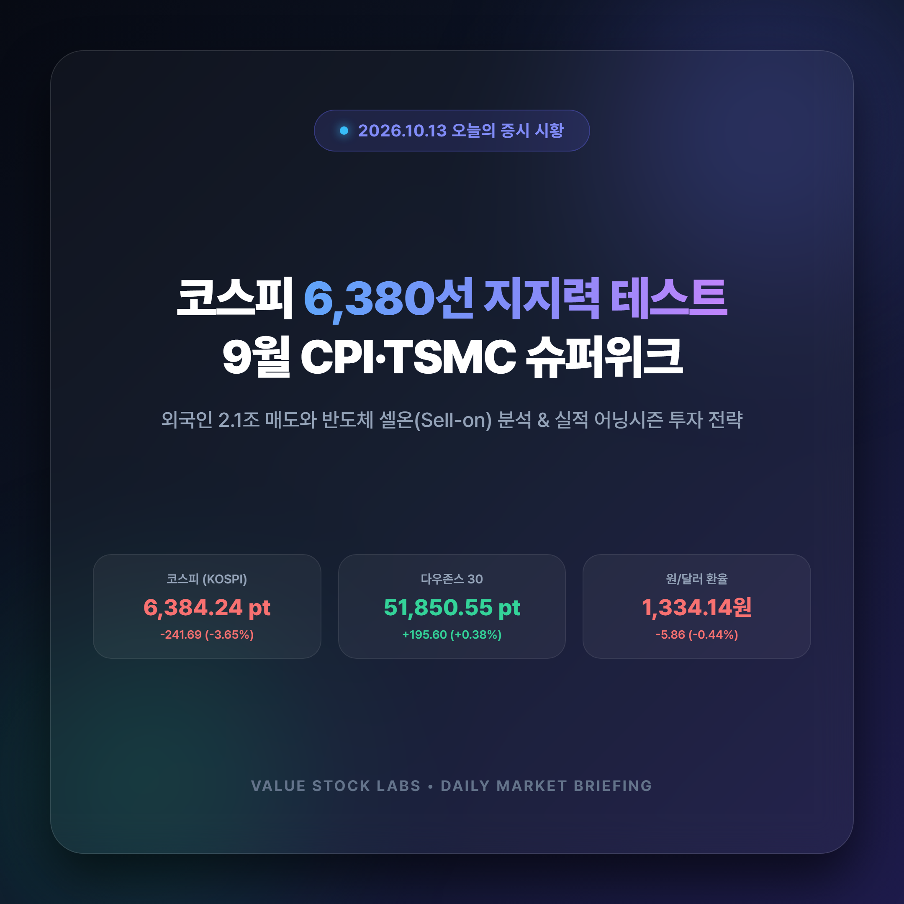
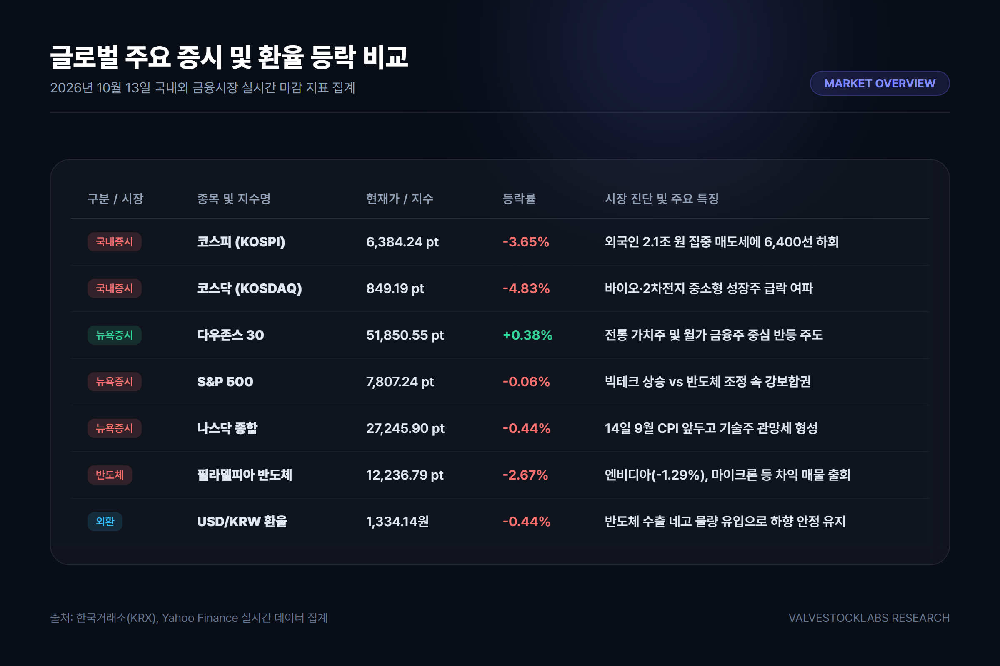
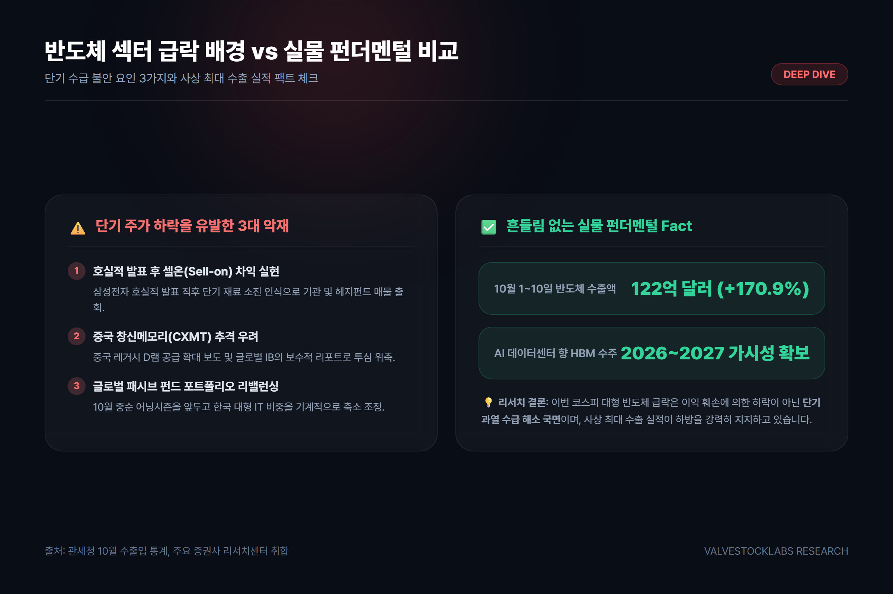
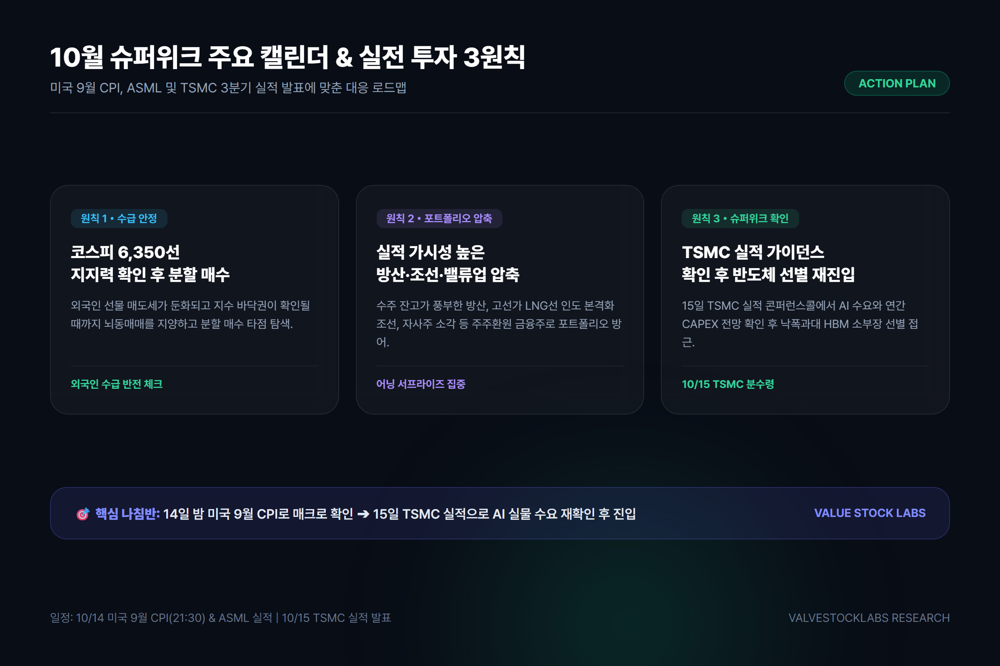

# 오늘의 증시 시황: 코스피 6,380선 지지력 테스트와 뉴욕증시 혼조, 9월 CPI·TSMC 슈퍼위크 투자 전략

> **코스피가 외국인의 2조 원대 집중 순매도세에 밀려 6,384선으로 급락한 가운데, 간밤 뉴욕증시는 다우 강세와 기술주 혼조를 나타냈습니다. 이번 주 9월 CPI와 TSMC 실적 발표를 앞둔 10월 어닝시즌 실전 대응 전략을 총정리해 드립니다.**

---

## 목차
- [1. 국내 증시 현황: 코스피 6,380선 급락과 외국인 2조 원 매도 충격](#1-국내-증시-현황-코스피-6380선-급락과-외국인-2조-원-매도-충격)
- [2. 뉴욕증시 및 환율 동향: 3대 지수 혼조와 1,330원대 안정세](#2-뉴욕증시-및-환율-동향-3대-지수-혼조와-1330원대-안정세)
- [3. 반도체 대형주 급락 배경: 셀온(Sell-on)과 실물 펀더멘털 분석](#3-반도체-대형주-급락-배경-셀온sell-on과-실물-펀더멘털-분석)
- [4. 이번 주 증시 분수령: 미국 9월 CPI와 TSMC 실적 캘린더](#4-이번-주-증시-분수령-미국-9월-cpi와-tsmc-실적-캘린더)
- [5. 투자자 실전 대응 로드맵 3원칙](#5-투자자-실전-대응-로드맵-3원칙)
- [6. 결론 및 요약](#6-결론-및-요약)

---

## 1. 국내 증시 현황: 코스피 6,380선 급락과 외국인 2조 원 매도 충격

국내 주식시장이 연휴 이후 재개장한 직후 거센 수급 변동성에 직면했습니다. 외국인 투자자의 대규모 매도 물량이 쏟아지며 코스피 지수는 단숨에 6,380선까지 밀려났습니다.

### 국내 증시 주요 지표 및 수급 현황

| 지수 / 주체 | 전일 종가 및 집계치 | 전일 대비 등락률 | 수급 특징 및 주요 동향 |
| :--- | :--- | :--- | :--- |
| **코스피(KOSPI)** | **6,384.24 pt** | **-3.65%** | 외국인 2.1조 원 집중 매도세에 6,400선 하회 |
| **코스닥(KOSDAQ)** | **849.19 pt** | **-4.83%** | 바이오·2차전지 중소형 성장주 급락 여파 |
| **외국인 순매도** | **-2조 1,400억 원** | - | 전기전자(삼성전자, SK하이닉스) 업종에 매도 집중 |
| **기관 순매도** | **-8,200억 원** | - | 금융투자·연기금 중심 프로그램 차익 매물 출회 |
| **개인 순매수** | **+2조 9,000억 원** | - | 6,380선 지지력 기대 저가 반발 매수세 유입 |

유가증권시장에서 외국인은 하루 만에 2조 1,400억 원을 순매도하며 시장 하락을 주도했습니다. 특히 시가총액 최상단에 위치한 **삼성전자(250,500원, -4.39%)**와 **SK하이닉스(1,605,000원, -4.52%)**에 매도세가 집중되며 지수 낙폭을 키웠습니다. 

반면 **LG에너지솔루션(398,000원, -0.75%)**과 **현대차(320,000원, -1.39%)** 등 상대적으로 밸류에이션 부담이 덜하고 실적 방어력이 입증된 종목들은 지수 대비 선방하는 차별화 양상을 나타냈습니다.

---

## 2. 뉴욕증시 및 환율 동향: 3대 지수 혼조와 1,330원대 안정세

간밤 미국 뉴욕증시는 이번 주 예정된 주요 물가 지표와 실적 발표를 앞두고 관망세가 짙어지며 혼조세로 거래를 마쳤습니다.

### 뉴욕 3대 지수 및 핵심 매크로 지표

- **다우존스 30 산업평균지수**: **51,850.55 pt (+0.38%)** - 전통 가치주와 금융주 중심 반등
- **S&P 500 지수**: **7,807.24 pt (-0.06%)** - 빅테크 상승과 반도체 하락이 맞물려 보합권
- **나스닥 종합지수**: **27,245.90 pt (-0.44%)** - 기술주 차익 실현에 따른 소폭 조정
- **필라델피아반도체 지수**: **12,236.79 pt (-2.67%)** - 엔비디아(-1.29%), 브로드컴(-1.88%) 등 하드웨어 약세
- **원/달러 환율**: **1,334.14원 (-0.44%)** - 수출 네고 물량 유입으로 하향 안정 유지

뉴욕증시에서는 종목별 차별화가 극명했습니다. **메타(+3.38%)**, **애플(+1.29%)**, **마이크로소프트(+1.14%)** 등 견고한 현금 흐름을 자랑하는 초대형 플랫폼 빅테크는 상승세를 이어갔으나, 반도체 하드웨어 기업들은 단기 밸류에이션 부담에 따른 숨고르기 양상을 보였습니다.

주목할 점은 **원/달러 환율**의 흐름입니다. 국내 증시의 급락에도 불구하고 원/달러 환율은 전일 대비 5.86원 하락한 **1,334.14원**을 기록했습니다. 반도체와 완성차 업계의 대규모 달러 매도(네고) 물량이 지속적으로 유입되며 환율 변동성을 안정적으로 제어하고 있습니다.

---

## 3. 반도체 대형주 급락 배경: 셀온(Sell-on)과 실물 펀더멘털 분석

시장 참가자들의 가장 큰 의문은 "사상 최대 실적에도 불구하고 왜 반도체 주가가 급락하는가?"입니다. 이번 조정은 펀더멘털의 훼손이 아닌 복합적인 수급 이슈에서 기인합니다.

### 급락을 유발한 3대 단기 악재

1. **호실적 발표 후 셀온(Sell-on) 현상**:
   삼성전자의 3분기 잠정 호실적 발표 이후, 단기적으로 추가적인 주가 모멘텀이 부재하다는 인식 속에 국내외 기관의 차익 실현 매물이 집중되었습니다.
2. **중국 창신메모리(CXMT) 추격 우려**:
   중국 업체의 레거시 D램 공급 확대 소식과 일부 외국계 증권사의 보수적 전망 리포트가 투자 심리를 냉각시켰습니다.
3. **글로벌 패시브 펀드 리밸런싱**:
   10월 중순 실적 시즌을 앞두고 글로벌 헤지펀드들이 단기 급등했던 한국 IT 반도체 비중을 기계적으로 축소하는 포트폴리오 조정이 진행되었습니다.

### 펀더멘털은 견고하다: 관세청 10월 수출 속보치

단기 주가 조정에도 불구하고 실물 경기의 체력은 견고합니다. 관세청이 발표한 10월 1~10일 수출입 통계에 따르면, **반도체 수출액은 122억 달러를 기록해 전년 동기 대비 170.9% 폭증**했습니다. 

AI 데이터센터向 HBM3E 및 6세대 HBM4 수주 가시성이 2026~2027년까지 확고한 만큼, 증권가에서는 이번 조정을 구조적 위기가 아닌 **'단기 과열 해소 및 건전한 가격 조정'**으로 평가하고 있습니다.

---

## 4. 이번 주 증시 분수령: 미국 9월 CPI와 TSMC 실적 캘린더

이번 주는 10월 증시의 중단기 방향성을 결정짓는 매크로 및 실적의 '슈퍼위크(Super Week)'입니다.

### 이번 주 핵심 글로벌 증시 캘린더

- **10월 14일(수) 밤 21:30 [한국시간] - 미국 9월 소비자물가지수(CPI)**:
  미 연방준비제도(Fed)의 향후 금리 인하 경로를 결정지을 핵심 척도입니다. 물가 지표가 시장 예상치에 부합할 경우 11월 FOMC 금리 완화 기대감이 한층 강화될 수 있습니다.
- **10월 14일(수) 장중 - ASML 3분기 실적 발표**:
  반도체 장비의 핵심인 EUV 노광장비 신규 수주 잔고 추이를 통해 글로벌 반도체 CAPEX 사이클을 진단할 수 있습니다.
- **10월 15일(목) 장중 - 대만 TSMC 3분기 실적 발표**:
  글로벌 파운드리 1위 기업 TSMC는 이미 **3분기 잠정 매출 467억 달러(+50% 폭증)**로 사상 최대 실적을 예고했습니다. 콘퍼런스콜에서 발표될 연간 설비투자(CAPEX) 가이던스와 AI 칩 수요 지속 여부가 글로벌 반도체주 반등의 열쇠입니다.
- **10월 15~16일 - 월가 대형 금융주 실적**:
  JP모건, 웰스파고, 블랙록 등의 실적 발표로 미국 3분기 어닝시즌이 본격적으로 막을 올립니다.

---

## 5. 투자자 실전 대응 로드맵 3원칙

변동성이 극대화된 국면에서 개인 투자자가 취해야 할 실전 대응 전략은 명확합니다.

### 실전 투자 가이드라인 3대 수칙

1. **코스피 6,350~6,380선 지지력 확인 후 분할 매수**:
   외국인의 선물 매도세가 둔화되고 지수가 바닥권을 다지는 시점까지는 섣부른 몰빵 매수를 피하고, 분할 매수 관점으로 신중히 접근해야 합니다.
2. **실적 방어주 및 밸류업 종목으로 포트폴리오 압축**:
   단순 테마주를 지양하고, 수주 잔고가 풍부한 **방산주**, 고선가 LNG선 인도가 시작된 **조선주**, 자사주 소각 등 주주환원이 명확한 **저PBR 금융주**로 하방을 지지해야 합니다.
3. **TSMC 가이던스 확인 후 반도체 재진입**:
   15일 TSMC의 AI 칩 수요 전망을 확인한 뒤, 낙폭이 과대했던 HBM 밸류체인 소부장 대장주를 선별적으로 공략하는 전략이 유효합니다.

---

## 6. 결론 및 요약

- **지수 조정**: 외국인 2.1조 원 순매도로 코스피는 6,384.24선으로 급락했으나, 원/달러 환율은 1,334원대로 안정세를 유지하고 있습니다.
- **반도체 진단**: 이번 반도체주 약세는 실적 피크아웃이 아닌 단기 셀온(Sell-on)과 리밸런싱에 따른 수급 충격이며, 10월 1~10일 반도체 수출은 170.9% 증가하며 사상 최대치를 경신했습니다.
- **전략 제언**: 14일 미국 CPI와 15일 TSMC 실적 발표 전까지는 보수적으로 지지선을 확인하되, 실적 가시성이 담보된 주도주로 포트폴리오를 압축해 대응하시길 권장합니다.

---

> **투자 유의사항 (Disclaimer)**  
> 본 글은 신뢰할 수 있는 공개 금융 데이터 및 증권사 리포트를 바탕으로 작성된 시장 분석 정보이며, 특정 종목에 대한 매수 또는 매도 추천이 아닙니다. 모든 투자의 최종 결정과 책임은 투자자 본인에게 있습니다.

---

### 참고 자료 및 출처 (Sources)
1. [한국거래소(KRX) 정보데이터시스템](http://data.krx.co.kr) - 10월 12~13일 국내 증시 투자자별 순매수 및 시가총액 통계
2. [Yahoo Finance](https://finance.yahoo.com) - 글로벌 주요 지수(다우, S&P500, 나스닥, SOX) 및 원/달러 환율 실시간 시세
3. [관세청 수출입무역통계](https://unipass.customs.go.kr) - 2026년 10월 1~10일 수출입 잠정치(반도체 수출 122억 달러 집계)
4. [연합인포맥스 금융시장 시황](https://news.einfomax.co.kr) - 코스피 외국인 수급 및 반도체 셀온 현상 분석
5. [TSMC Investor Relations](https://investor.tsmc.com) - TSMC 3분기 잠정 매출 467억 달러 집계 및 콘퍼런스콜 일정 공시
6. [Upbit 암호화폐 실시간 시세](https://upbit.com) - 가상자산 비트코인 및 알트코인 시세 데이터
