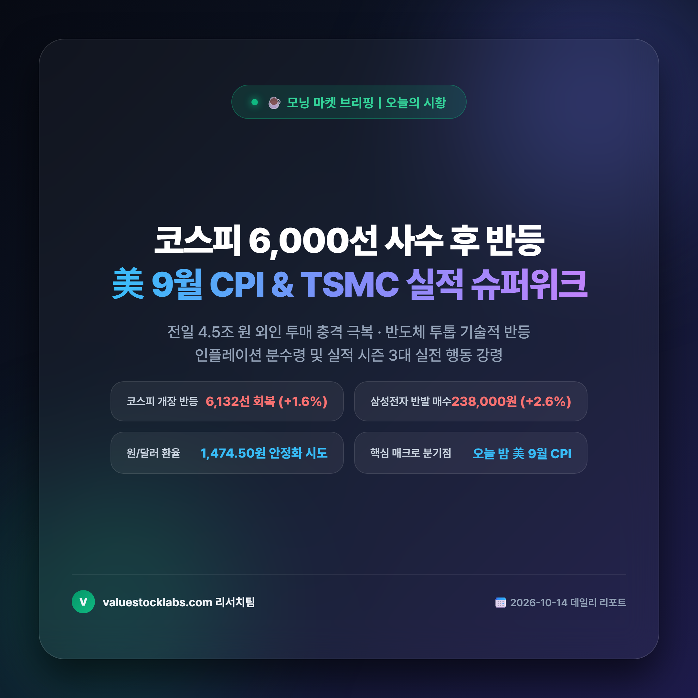
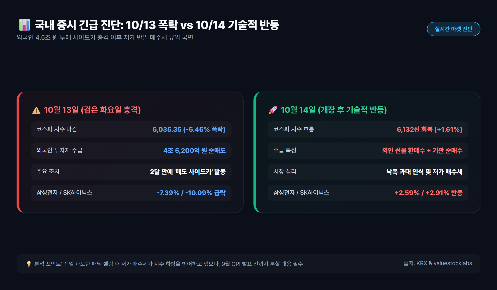
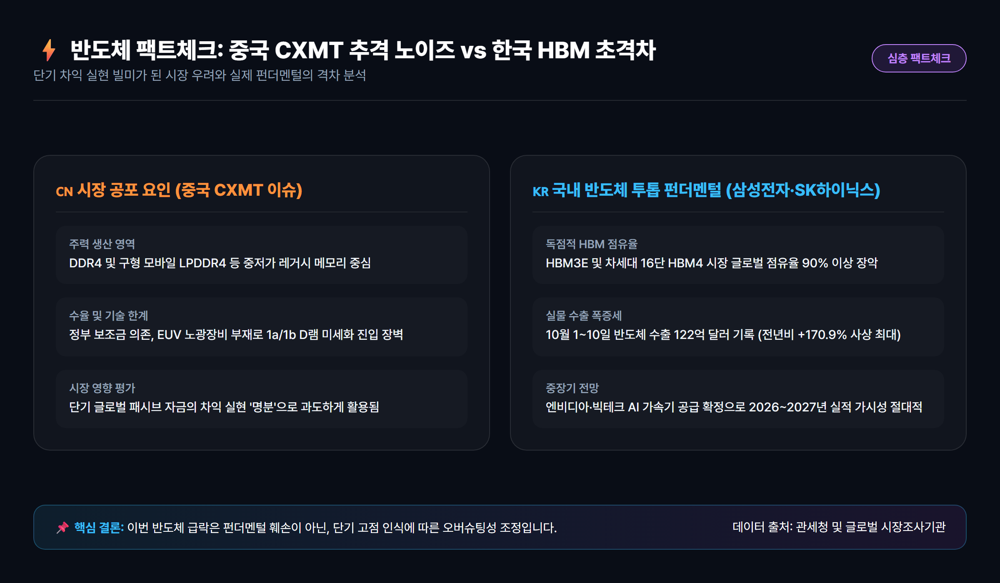
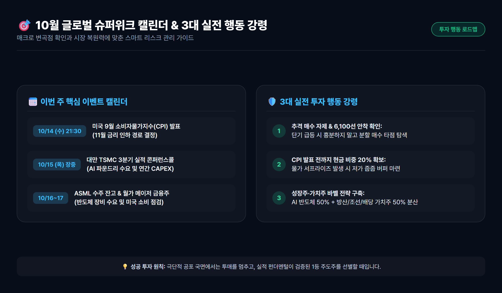

# 오늘의 증시 시황: 코스피 6,000선 사수 후 반등 개장, 9월 CPI·TSMC 실적 슈퍼위크 투자 전략

> 전일 4.5조 원 외국인 투매와 사이드카 충격을 딛고 6,100선 반등을 시도하는 국내 증시! 반도체 투톱 기술적 반등의 의미와 오늘 밤 미국 9월 CPI, 내일 TSMC 실적 발표를 앞둔 3대 실전 대응 로드맵을 총정리합니다.

---

## 목차
- [1. 국내 증시 현황: '검은 화요일' 사이드카 충격과 14일 6,100선 반등 개장](#1-국내-증시-현황-검은-화요일-사이드카-충격과-14일-6100선-반등-개장)
- [2. 글로벌 증시 및 매크로 지표: 뉴욕증시 혼조 마감과 환율 변동성 점검](#2-글로벌-증시-및-매크로-지표-뉴욕증시-혼조-마감과-환율-변동성-점검)
- [3. 반도체 급락 노이즈 분석: 중국 CXMT 추격 우려 vs HBM 초격차 진실](#3-반도체-급락-노이즈-분석-중국-cxmt-추격-우려-vs-hbm-초격차-진실)
- [4. 이번 주 핵심 이벤트 일정 및 실전 투자 전략 3원칙](#4-이번-주-핵심-이벤트-일정-및-실전-투자-전략-3원칙)
- [5. 결론 및 오늘의 투자 인사이트](#5-결론-및-오늘의-투자-인사이트)

---

## 1. 국내 증시 현황: '검은 화요일' 사이드카 충격과 14일 6,100선 반등 개장

10월 13일 국내 증시는 이른바 **'검은 화요일'**이라 불릴 만큼 극심한 변동성에 직면했습니다. 외국인 투자자가 하루 만에 **4조 5,200억 원**이라는 사상 유례없는 규모의 순매도 폭탄을 쏟아내면서 코스피 지수는 전 거래일 대비 **-5.46%(348.89 pt)** 폭락한 **6,035.35**로 마감했습니다. 

장중 한때 코스피200 선물 급락으로 인해 지난 8월 이후 약 두 달 만에 **매도 사이드카(Sidecar)**가 전격 발동되며 6,000선 붕괴 위기까지 몰렸으나, 5조 원이 넘는 개인 투자자의 저가 반발 매수세가 유입되며 마지노선인 6,000선을 간신히 사수했습니다.

그러나 하루 뒤인 **10월 14일 개장 상황**은 반전의 기류를 보이고 있습니다. 전일 과도한 투매에 따른 낙폭 과대 인식이 확산되며 코스피는 **6,062.08(+0.44%)**로 반등 출발한 후, 외국인의 선물 환매수와 기관의 동반 매수세에 힘입어 장 초반 **6,120~6,140선(+1.4%~+1.8%)**을 단숨에 회복하고 있습니다.

### 주요 지표 및 시총 상위 종목 변동 현황

| 구분 | 10월 13일(전일 마감) | 10월 14일(장 초반 흐름) | 핵심 변동 원인 및 특징 |
|---|---|---|---|
| **코스피(KOSPI)** | **6,035.35 (-5.46%)** | **6,132.50 (+1.61%)** | 매도 사이드카 해제 후 기술적 반발 매수 유입 |
| **코스닥(KOSDAQ)** | **820.15 (-6.01%)** | **834.40 (+1.74%)** | 과매도 대형 바이오·소부장 중심 반등 시도 |
| **삼성전자** | 232,000원 (-7.39%) | 238,000원 (+2.59%) | 외국인 6거래일 연속 매도 둔화 및 저가 매수세 |
| **SK하이닉스** | 1,443,000원 (-10.09%) | 1,485,000원 (+2.91%) | HBM4 펀더멘털 신뢰 속 148만 원선 회복 |
| **원/달러 환율** | 1,478.20원 (+12.40원) | 1,474.50원 (-3.70원) | 달러 강세 압력 완화 및 수출 네고 물량 유입 |

전일 7%에서 10% 가까이 기록적으로 폭락했던 반도체 대장주 삼성전자와 SK하이닉스가 나란히 2% 중후반의 기술적 반등을 기록하며 지수의 하방 경직성을 강하게 지지해주고 있습니다.

---

## 2. 글로벌 증시 및 매크로 지표: 뉴욕증시 혼조 마감과 환율 변동성 점검

간밤 미국 뉴욕증시는 아시아 반도체 급락 충격에도 불구하고 비교적 양호한 하방 지지력을 보이며 약보합 혼조세로 마감했습니다. 

- **다우존스 30 산업평균지수**: 51,670.10 pt (-180.45 pt, **-0.35%**)
- **S&P 500 지수**: 7,805.45 pt (-1.79 pt, **-0.02%**)
- **나스닥 종합지수**: 27,204.38 pt (-41.52 pt, **-0.15%**)
- **필라델피아반도체 지수**: 12,050.20 pt (-186.59 pt, **-1.52%**)

미국 시장에서도 마이크론(-3.62%)과 인텔, 브로드컴 등 반도체 하드웨어 주가 일시적인 조정 압력을 받았으나, **엔비디아($227.10, +0.35%)**, **애플(+0.85%)**, **알파벳(+0.62%)** 등 메가캡 빅테크 기업들이 견조한 상승세를 유지하며 시장 전체의 패닉을 막아냈습니다.

특히 연방준비제도(Fed) 주요 인사들의 완화적(Dovish) 코멘트가 이어지며 **미국 10년물 국채금리가 4.02% 선으로 하향 안정**된 점이 글로벌 위험자산 투자 심리를 되살리는 결정적 방아쇠가 되었습니다.

다만, 외환시장에서의 원/달러 환율은 여전히 주의가 필요합니다. 외국인의 대규모 주식 매도에 따른 원화 환전 수요와 글로벌 달러화 선호가 맞물리며 환율이 **1,470원대 후반**에서 고공행진 중이므로, 환율 안정세가 확인되기 전까지는 외국인 현물 수급의 지속성을 단언하기 어렵습니다.

---

## 3. 반도체 급락 노이즈 분석: 중국 CXMT 추격 우려 vs HBM 초격차 진실

이번 10월 증시 급락의 핵심 진원지는 바로 **'반도체 고점론'**과 **'중국 창신메모리(CXMT) 추격 노이즈'**였습니다.

글로벌 헤지펀드와 일부 외국계 IB들은 중국 정부의 막대한 보조금을 등에 업은 CXMT가 차세대 D램 양산에 돌입했으며, 서버용 제품 공급을 가시화하고 있다는 외신 보도를 빌미로 차익 실현 매물을 쏟아냈습니다. 여기에 3분기 빅테크의 AI 설비투자(CAPEX) 대비 수익성 회수(ROI) 속도가 둔화될 수 있다는 우려가 기름을 부었습니다.

하지만 데이터와 펀더멘털을 냉정하게 분석해 보면 시장의 공포는 지나치게 과장되어 있습니다.

1. **제품 영역의 절대적 괴리**:
   - 중국 CXMT의 기술력은 여전히 DDR4 및 구형 모바일 LPDDR4X 등 **레거시(범용) 범주**에 집중되어 있습니다.
   - 엔비디아의 차세대 블랙웰 울트라(Blackwell Ultra) 및 루빈(Rubin) 플랫폼에 탑재되는 **12단/16단 HBM3E 및 HBM4, 고용량 DDR5 서버 모듈** 시장에서 한국 메모리 업체의 점유율은 90% 이상을 확고히 유지하고 있습니다.
2. **실물 수출 데이터의 견고함**:
   - 관세청이 공식 집계한 **2026년 10월 1~10일 반도체 수출액은 122억 달러**로, 전년 동기 대비 **+170.9%**라는 폭발적인 성장세를 기록했습니다.
   - 즉, 실적과 수출 펀더멘털의 훼손이 아니라 **단기 급등에 따른 차익 실현 욕구와 패시브 수급 쏠림이 빚어낸 일시적 오버슈팅성 조정**으로 보는 것이 타당합니다.

---

## 4. 이번 주 핵심 이벤트 일정 및 실전 투자 전략 3원칙

이번 주는 2026년 하반기 증시의 중장기 추세를 가를 **'글로벌 슈퍼위크'**입니다. 오늘 밤부터 굵직한 매크로 및 메가 실적 지표가 연이어 쏟아집니다.

### 금주 핵심 매크로 & 실적 캘린더

1. **10월 14일(수) 21:30 [한국시간]**: **미국 9월 소비자물가지수(CPI) 발표**
   - 헤드라인 및 근원 물가가 시장 예상치(전년비 2.3~2.4%)에 부합하거나 하회할 경우, 11월 FOMC에서의 25~50bp 추가 금리 인하 확률이 80% 이상으로 치솟으며 안도 랠리의 기폭제가 될 수 있습니다.
2. **10월 15일(목) 장중**: **대만 TSMC 3분기 실적 콘퍼런스콜**
   - 잠정 3분기 매출 467억 달러(사상 최대) 발표에 이어, AI 가속기 웨이퍼 수주 및 2026~2027년 연간 CAPEX 상향 여부가 전 세계 반도체주의 운명을 결정짓습니다.
3. **10월 16~17일**: **ASML EUV 노광장비 수주 잔고 공개 & 월가 메이저 금융사 실적 발표**
   - 차세대 High-NA EUV 발주 규모와 미국 소비 경기 둔화 여부를 최종 가늠하게 됩니다.

### 실전 투자자를 위한 3대 행동 강령

- **원칙 1 [패닉 바잉 자제, 6,100선 안착 확인 후 분할 매수]**:
  - 사이드카 직후 첫 반등일에는 장중 변동성이 극심합니다. 급등 종목을 무리하게 추격 매수하기보다는 6,050~6,100선의 주봉상 지지력을 테스트하는 캔들을 확인하며 2~3회 분할 진입하는 것이 안전합니다.
- **원칙 2 [오늘 밤 미국 CPI 지표 전까지 현금 비중 20% 유지]**:
  - 오늘 밤 물가 지표가 예상치를 상회할 경우 단기 금리 변동성이 재점화될 수 있습니다. 방향성 확정 전까지 최소 20% 내외의 현금 비중을 방어 버퍼로 확보해 두어야 합니다.
- **원칙 3 [실적 확실한 가치주·고배당주로 포트폴리오 바벨 전략 구축]**:
  - 성장주 단일 쏠림을 피하고, 3분기 호실적이 확실시되는 방산(해외 수주잔고 급증), 조선(고선가 친환경 선박 인도), 밸류업 금융지주(자사주 소각 공시) 등 하방 경직성이 보장된 우량주를 5:5 비율로 분산 배치하십시오.

---

## 5. 결론 및 오늘의 투자 인사이트

10월 13일의 코스피 6,000선 공방전은 시장 참여자들에게 큰 심리적 공포를 안겨주었지만, 역사적으로 펀더멘털이 훼손되지 않은 상태에서 발생한 급락과 사이드카 발동은 **우량 주도주를 매력적인 가격에 담을 수 있는 최적의 분할 매수 기회**를 제공해 왔습니다.

오늘 14일 장 초반 6,100선 반등은 시장의 자생적 복원력을 증명하고 있습니다. 오늘 밤 공개될 미국 9월 CPI와 내일 TSMC의 실적 발표라는 두 개의 거대한 관문을 확인하면서, 단기 소음에 흔들리지 않고 실적 가시성이 검증된 핵심 AI 반도체 밸류체인과 가치주로 포트폴리오를 압축 재편할 것을 권장합니다.

---
*면책 조항: 본 리포트는 신뢰할 수 있는 공개 자료를 바탕으로 작성된 정보 제공 목적의 콘텐츠이며, 특정 주식의 매수·매도 추천이나 금융 투자에 대한 자문이 아닙니다. 모든 투자의 최종 판단과 결과에 대한 책임은 투자자 본인에게 귀속됩니다.*
