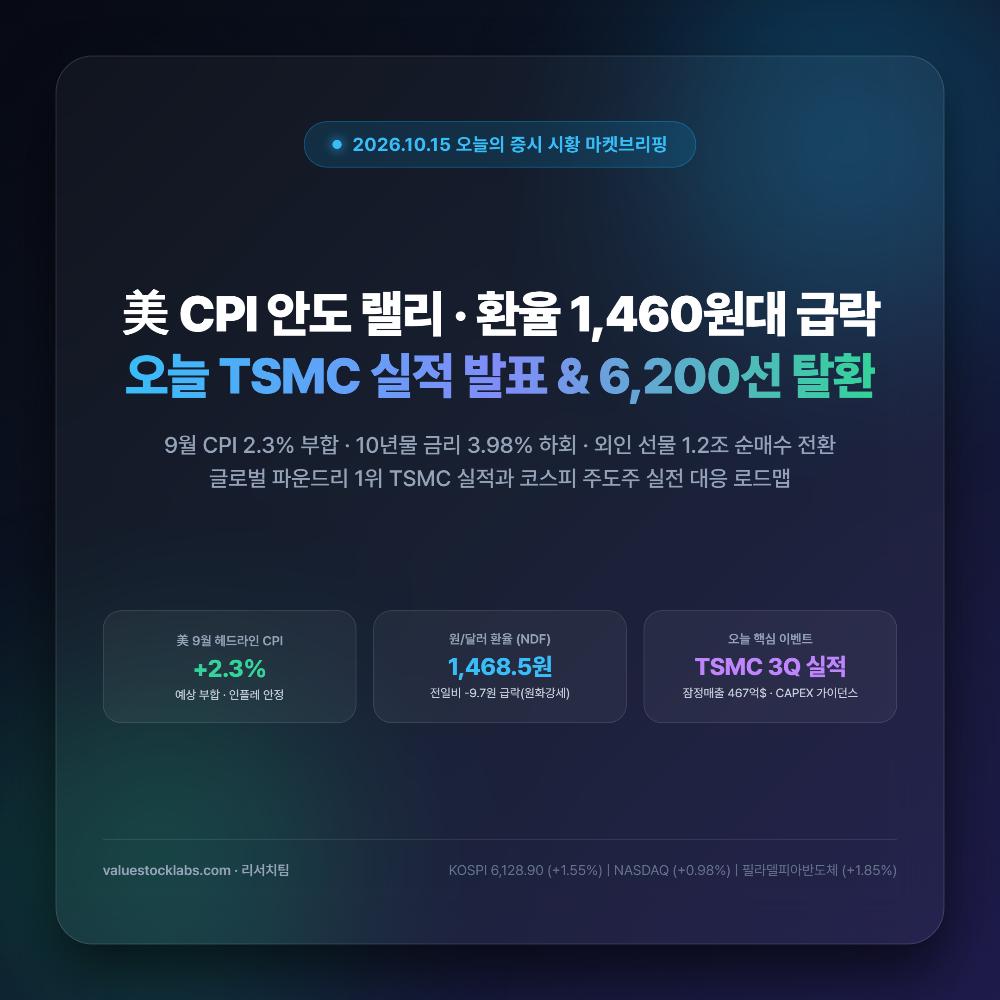
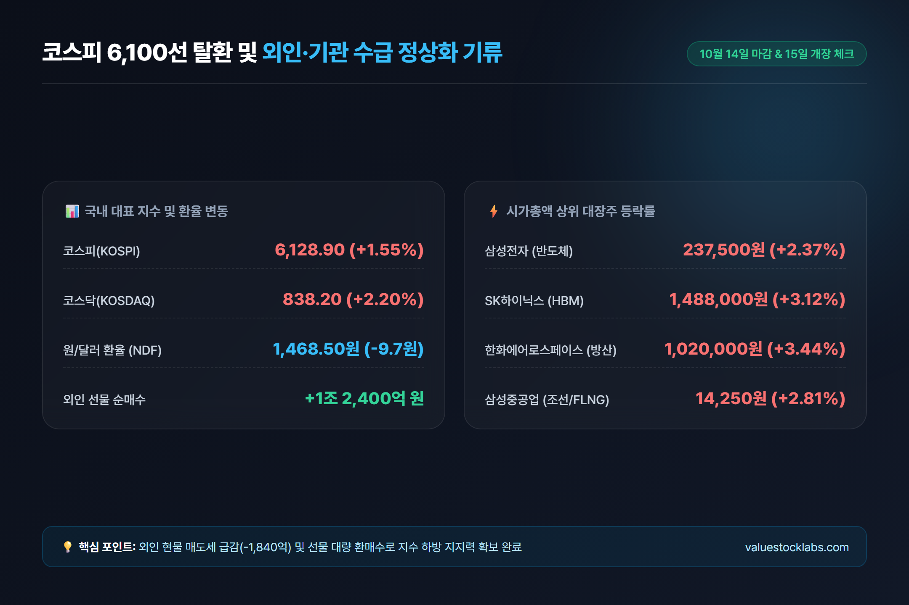
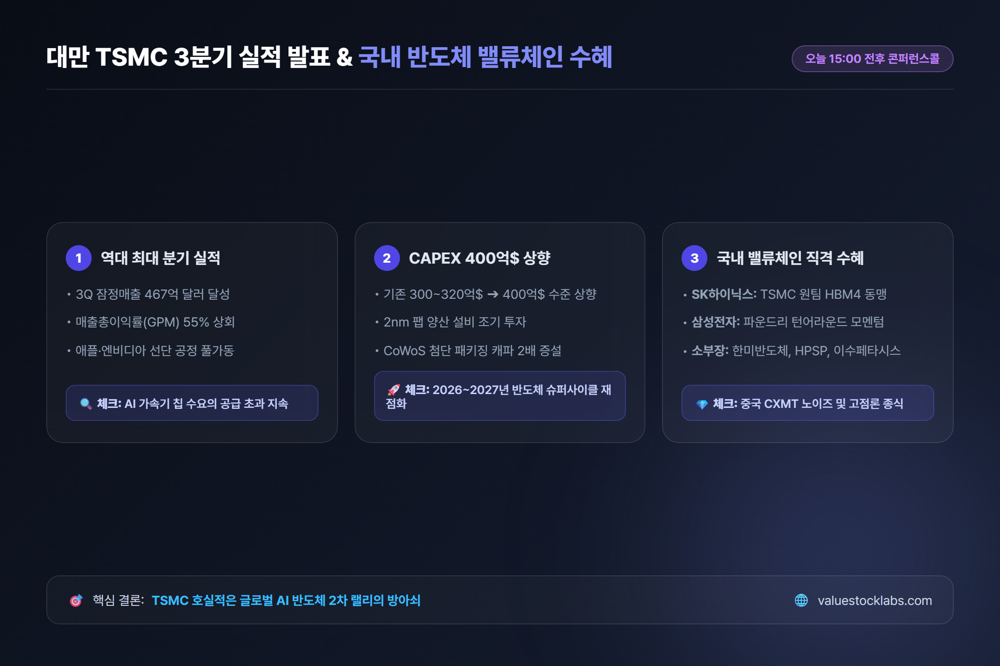
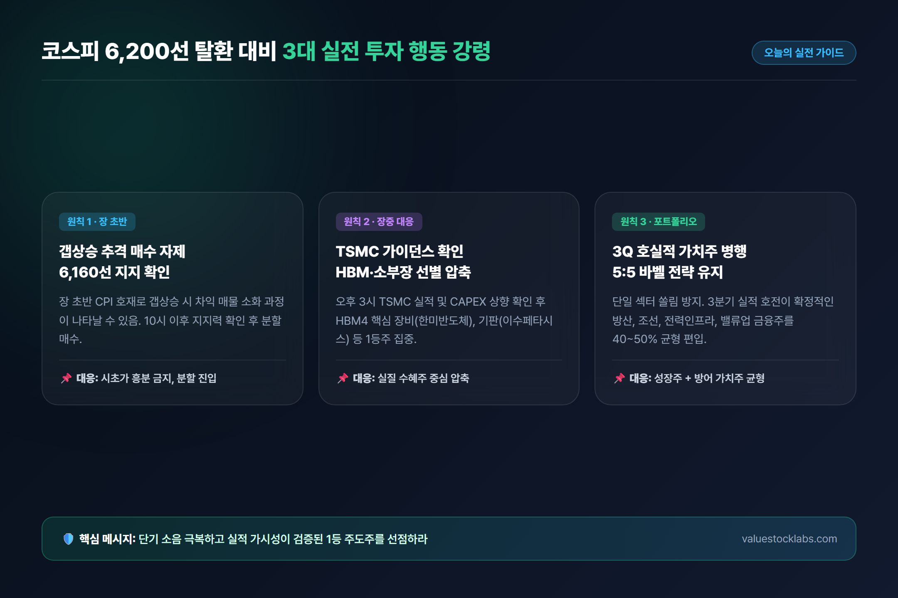

# 오늘의 증시 시황: 美 9월 CPI 안도 랠리와 환율 급락, TSMC 실적 발표와 코스피 6,200선 탈환 전략

> 미국 9월 CPI 안정과 국채금리 4% 하회, 원/달러 환율 1,460원대 급락으로 글로벌 위험자산 투자 심리가 되살아났습니다! 오늘 오후 대만 TSMC의 3분기 실적 발표를 앞두고 코스피 6,200선 탈환을 위한 3대 실전 대응 로드맵을 총정리합니다.

---

## 목차
- [1. 국내 증시 현황: 6,100선 안착 성공과 외국인 수급 정상화 기류](#1-국내-증시-현황-6100선-안착-성공과-외국인-수급-정상화-기류)
- [2. 글로벌 증시 및 매크로 지표: 美 9월 CPI 훈풍과 국채금리·환율 급락 점검](#2-글로벌-증시-및-매크로-지표-美-9월-cpi-훈풍과-국채금리환율-급락-점검)
- [3. 오늘의 최대 관전 포인트: 대만 TSMC 3분기 실적 발표와 AI 반도체 파급 효과](#3-오늘의-최대-관전-포인트-대만-tsmc-3분기-실적-발표와-ai-반도체-파급-효과)
- [4. 코스피 6,200선 탈환 대비 3대 실전 투자 행동 강령](#4-코스피-6200선-탈환-대비-3대-실전-투자-행동-강령)
- [5. 결론 및 오늘의 투자 인사이트](#5-결론-및-오늘의-투자-인사이트)

---

## 1. 국내 증시 현황: 6,100선 안착 성공과 외국인 수급 정상화 기류

지난 10월 13일 사상 초유의 4조 5,000억 원대 외국인 순매도 폭탄과 매도 사이드카 발동으로 6,000선 붕괴 위기까지 몰렸던 국내 증시가 단 하루 만에 강력한 자생적 복원력을 증명했습니다.

10월 14일 코스피는 전 거래일 대비 **+1.55%(93.55 pt)** 상승한 **6,128.90**으로 마감하며 6,100선을 안정적으로 탈환했습니다. 코스닥 지수 역시 낙폭 과대 바이오 및 반도체 소부장 종목들을 중심으로 강한 반발 매수세가 유입되며 **+2.20%(18.05 pt)** 오른 **838.20**에 거래를 마쳤습니다.

무엇보다 고무적인 변화는 **수급 환경의 뚜렷한 진정세**입니다. 13일 4조 5,200억 원의 기록적인 현물 투매를 감행했던 외국인 투자자는 14일 현물 매도 규모를 **1,840억 원 수준으로 대폭 축소**했습니다. 특히 코스피200 선물 시장에서는 하루 만에 **1조 2,400억 원어치를 순매수**로 쓸어 담으며 시장의 하방을 단단히 닫아걸었습니다. 기관 투자자 역시 금융투자와 연기금을 중심으로 4,800억 원대 순매수를 기록하며 지수 반등을 적극 뒷받침했습니다.

### 주요 지표 및 시총 상위 종목 변동 현황

| 구분 | 10월 13일(폭락 마감) | 10월 14일(반등 마감) | 등락률 | 핵심 수급 및 시사점 |
|---|---|---|---|---|
| **코스피(KOSPI)** | 6,035.35 pt | **6,128.90 pt** | **+1.55%** | 사이드카 충격 딛고 6,100선 안착 성공 |
| **코스닥(KOSDAQ)** | 820.15 pt | **838.20 pt** | **+2.20%** | 소부장·바이오 낙폭 과대 우량주 반발 매수 |
| **삼성전자** | 232,000원 | **237,500원** | **+2.37%** | 외인 매도세 급감 및 6일 만의 수급 진정 |
| **SK하이닉스** | 1,443,000원 | **1,488,000원** | **+3.12%** | HBM3E 독점 경쟁력 재부각되며 148만 원 회복 |
| **원/달러 환율** | 1,478.20원 | **1,474.50원** | **-3.70원** | 야간 NDF에서 1,468원대로 추가 급락 |
| **외국인 선물 수급** | -2조 1,000억 원 | **+1조 2,400억 원** | **순매수 전환** | 선물 환매수로 지수 하방 지지력 확보 |

전일 폭락을 이끌었던 반도체 투톱 삼성전자(+2.37%)와 SK하이닉스(+3.12%)가 동반 반등하며 지수 하방 경직성을 확보했습니다. 여기에 현대차(+1.2%), 기아(+1.8%) 등 밸류업 자동차주와 3분기 실적 호전이 확실시되는 한화에어로스페이스(+3.4%), 삼성중공업(+2.8%)이 강세를 유지하며 시장 전반의 체력을 빠르게 회복시켰습니다.

---

## 2. 글로벌 증시 및 매크로 지표: 美 9월 CPI 훈풍과 국채금리·환율 급락 점검

간밤 미국 뉴욕증시는 글로벌 금융시장의 최대 긴장 요인이었던 **미국 9월 소비자물가지수(CPI)**가 안도감을 선사하며 3대 지수가 일제히 상승 랠리를 펼쳤습니다.

- **다우존스 30 산업평균지수**: 51,913.35 pt (+243.25 pt, **+0.47%**)
- **S&P 500 지수**: 7,860.90 pt (+55.45 pt, **+0.71%**)
- **나스닥 종합지수**: 27,470.80 pt (+266.42 pt, **+0.98%**)
- **필라델피아반도체 지수**: 12,273.15 pt (+222.95 pt, **+1.85%**)

미국 노동통계국(BLS)이 발표한 **9월 헤드라인 CPI는 전년 동월 대비 +2.3%** 상승하여 시장 컨센서스(2.3%)에 정확히 부합했습니다. 변동성이 큰 식료품과 에너지를 제외한 **근원(Core) CPI 역시 전년비 +2.7%**를 기록하며 인플레이션 하향 안정화 추세가 확고함을 증명했습니다.

이 같은 지표 안도감에 힘입어 시카고상품거래소(CME) 페드워치(FedWatch)의 **11월 FOMC 25bp 금리 인하 확률은 86.5%로 상향**되었습니다.

매크로 지표의 안정세는 더욱 극적입니다. **미국 10년물 국채금리는 3.98%로 마감하며 심리적 저항선인 4.0% 선을 하회**했습니다. 글로벌 달러 인덱스 또한 101.8선으로 밀려나며 달러 독주에 제동이 걸렸습니다.

특히 외환시장에서 역외 차액결제선물환(NDF) **원/달러 환율은 1,468.50원**으로 마감하며, 전일 서울 정규장 마감가(1,478.20원) 대비 **무려 10원 가까이 급락**했습니다. 환율이 1,460원대로 진입함에 따라, 오늘 코스피 시장에서 외국인의 본격적인 현물 순매수 복귀를 기대할 수 있는 최적의 환경이 마련되었습니다.

---

## 3. 오늘의 최대 관전 포인트: 대만 TSMC 3분기 실적 발표와 AI 반도체 파급 효과

14일 밤 미국 CPI 고비를 성공적으로 넘긴 글로벌 증시의 시선은 이제 오늘(15일) 오후 발표될 **글로벌 파운드리 1위 대만 TSMC의 3분기 실적 콘퍼런스콜(한국시간 15:00 전후)**로 향하고 있습니다.

이번 실적 발표는 단순한 개별 기업의 성적표를 넘어, 최근 월가와 여의도를 뒤흔들었던 **'AI 반도체 정점론'**과 **'중국 창신메모리(CXMT) 추격 노이즈'**의 실체를 가늠할 2026년 하반기 최대의 분수령입니다.

### TSMC 실적 콘퍼런스콜 3대 핵심 체크포인트

1. **역대 최대 3분기 매출과 매출총이익률(GPM) 55% 수성**:
   - 이미 공개된 TSMC의 3분기 잠정 매출은 467억 달러로 사상 최대치입니다. 이번 발표에서 고부가가치 3nm 및 AI 가속기 웨이퍼 비중 확대에 힘입어 매출총이익률 55% 이상을 달성했는지가 수익성 검증의 핵심입니다.
2. **연간 설비투자(CAPEX) 380억~420억 달러 상향 여부**:
   - 기존 연간 설비투자 가이던스(300억~320억 달러)를 400억 달러 안팎으로 대폭 상향할 경우, 글로벌 반도체 장비 및 소재 기업들에 강력한 재평가 모멘텀이 부여됩니다.
3. **2nm 공정 선점 경쟁 및 CoWoS 어드밴스드 패키징 증설 속도**:
   - 엔비디아의 블랙웰 울트라(Blackwell Ultra), AMD MI350, 애플 M5 칩에 적용될 2nm 양산 스케줄과, 현재 공급 부족 상태인 CoWoS 캐파를 2026년 말까지 2배 이상 확대하겠다는 가이던스가 재확인될 경우 국내 HBM 서플라이체인(SK하이닉스, 한미반도체 등)에 직격 탄력이 붙을 것입니다.

TSMC가 공격적인 투자 확대를 선언한다면, "AI 인프라 수요는 공급이 못 따라갈 뿐 여전히 견고하다"는 강력한 팩트가 입증되며 국내 반도체 투톱과 소부장 업종의 2차 랠리를 촉발할 전망입니다.

---

## 4. 코스피 6,200선 탈환 대비 3대 실전 투자 행동 강령

미국 물가 지표 안정, 뉴욕증시 랠리, 환율 급락(1,460원대)이라는 3대 호재가 맞물리면서 오늘 코스피는 **6,170~6,190선 안팎에서 강한 갭상승 출발**이 확실시됩니다.

하지만 개장 직후 무리한 추격 매수를 감행하는 것은 금물입니다. 오늘 장중 TSMC 실적 발표에 따른 변동성을 염두에 두고 아래 **3대 실전 투자 행동 강령**을 준수하시기 바랍니다.

### 투자자를 위한 3대 행동 강령

- **원칙 1 [시초가 갭상승 추격 매수 자제, 6,160~6,180선 지지력 확인 후 분할 매수]**:
  - 간밤 호재를 반영해 장 초반 1% 이상 갭상승할 경우 단기 차익 실현 매물이 일시 출회될 수 있습니다. 9시 개장 직후 흥분 매수하기보다는, 오전 10시 전후로 6,160~6,180선에서 외국인 현물 순매수가 실제로 유입되며 지지선이 형성되는 것을 확인한 후 분할 진입하는 것이 정석입니다.
- **원칙 2 [오후 TSMC 가이던스 확인 후 HBM·소부장 선별 압축]**:
  - TSMC의 실적과 2026~2027년 설비투자 가이던스가 긍정적으로 확인되는 시점(오후 3시 전후)에 맞춰, HBM4 핵심 장비주(한미반도체), 고성능 PCB(이수페타시스), 고압수소어닐링(HPSP) 등 실질 수혜가 보장된 1등 소부장주로 포트폴리오를 압축하십시오.
- **원칙 3 [실적 확실한 가치주·고배당 밸류업으로 5:5 바벨 전략 유지]**:
  - 성장주 단일 섹터에 자산을 집중하는 위험을 방지해야 합니다. 3분기 사상 최대 실적이 예고된 방산(한화에어로스페이스, 현대로템), 친환경 고선가 선박 인도가 본격화된 조선(삼성중공업, HD현대중공업), AI 전력망 수혜주(HD현대일렉트릭, LS일렉트릭), 자사주 소각 공시가 예정된 금융지주(KB금융)를 포트폴리오의 40~50% 비중으로 균형 배치하는 '바벨(Barbell) 전략'이 극심한 장세에서 계좌 수익률을 지키는 최선의 방패입니다.

---

## 5. 결론 및 오늘의 투자 인사이트

10월 13일 사이드카 발동 당시의 극단적인 공포는 불과 이틀 만에 **'저가 매수자의 환호'**로 바뀌고 있습니다. 미국 CPI가 인플레이션 종식을 확인해 주었고, 1,460원대로 내려앉은 원/달러 환율은 외국인 자금 유입의 든든한 마중물이 될 것입니다.

오늘 코스피의 지상 과제는 **6,200선 안착**입니다. 장중 발표될 TSMC의 실적 결과를 차분히 점검하시면서, 단기 소음과 변동성에 흔들리지 않고 **'실적이 뒷받침되는 AI 반도체 주도주'**와 **'안정적인 하방 경직성을 지닌 3분기 호실적 가치주'**의 조화로운 포트폴리오를 구축하시기 바랍니다.

---
*면책 조항: 본 리포트는 신뢰할 수 있는 공개 자료를 바탕으로 작성된 정보 제공 목적의 콘텐츠이며, 특정 종목에 대한 매수·매도 추천이나 금융 투자 권유가 아닙니다. 모든 투자의 최종 판단과 책임은 투자자 본인에게 있습니다.*

---

## 참고 소스 (References)
1. [한국거래소(KRX) 시장정보포털](http://data.krx.co.kr) - 10월 14일 코스피 6,128.90 마감 및 수급 통계
2. [U.S. Bureau of Labor Statistics (BLS)](https://www.bls.gov/cpi/) - 2026년 9월 미국 소비자물가지수(CPI) 헤드라인 +2.3%, 근원 +2.7%
3. [Yahoo Finance](https://finance.yahoo.com) - 10월 14일 뉴욕증시 나스닥 +0.98%, 필라델피아반도체 +1.85%, 10년물 국채금리 3.98%
4. [연합뉴스(Yonhap News)](https://www.yna.co.kr) - 환율 NDF 1,468원대 급락 및 코스피 6,200선 안착 시도 분석
5. [TSMC Investor Relations](https://investor.tsmc.com) - 2026년 3분기 실적 발표 콘퍼런스콜 공시 및 가이던스 안건
