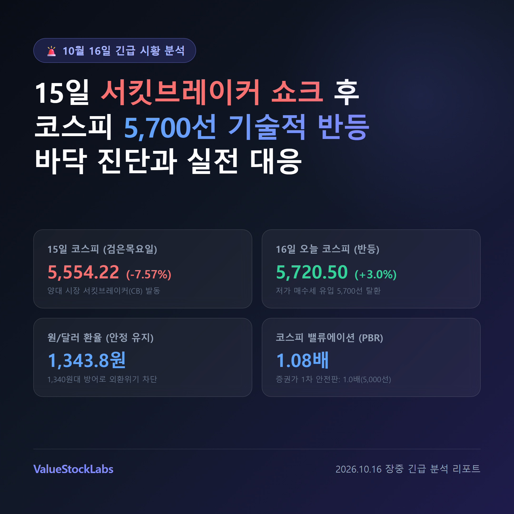
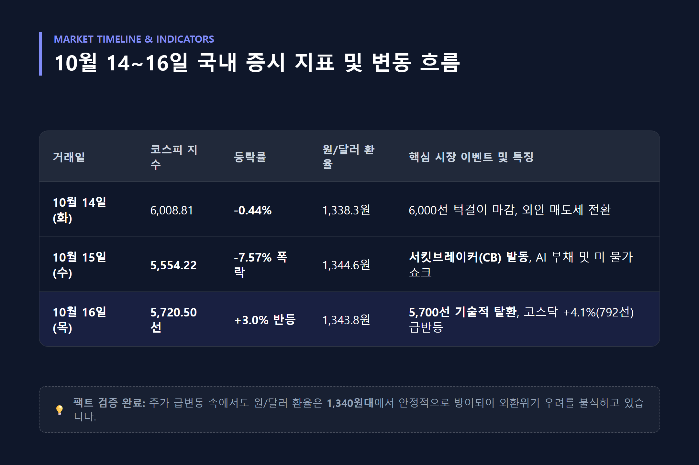
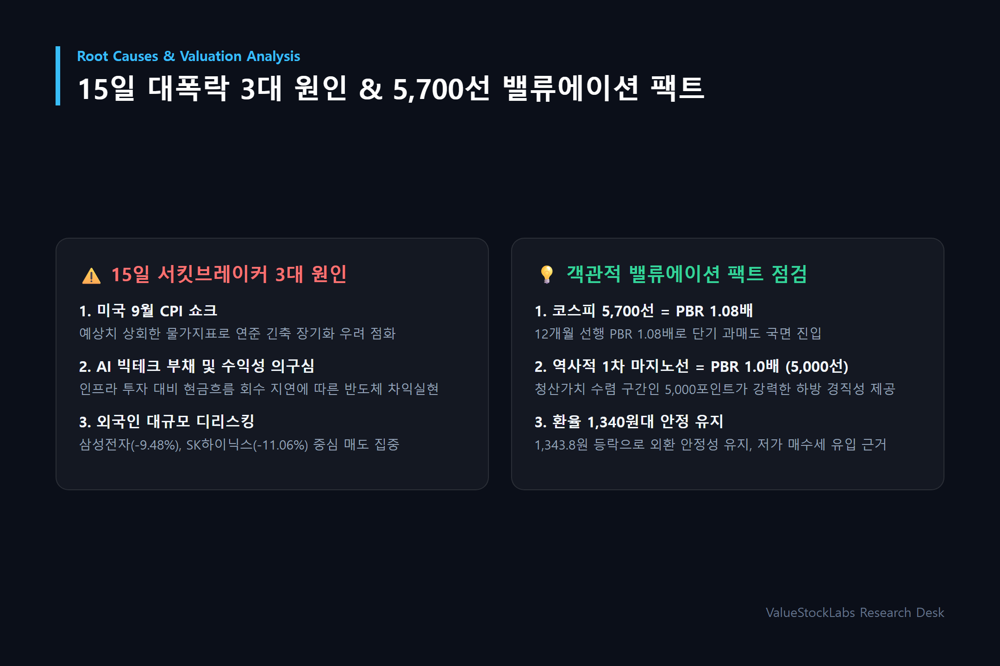
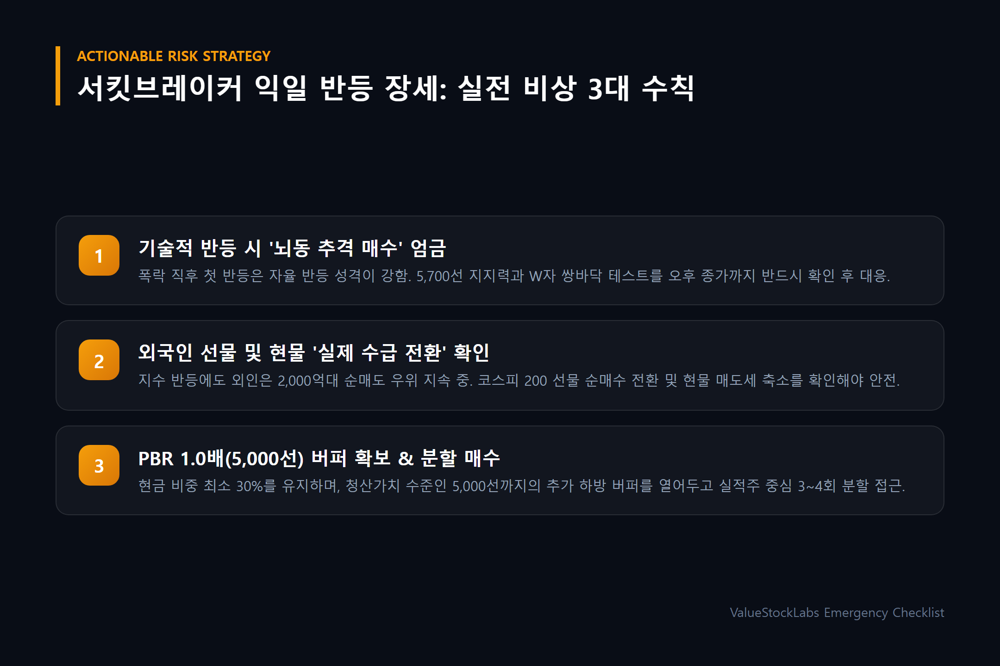

# 오늘의 증시 시황: 15일 서킷브레이커 쇼크 후 코스피 5,700선 반등... 환율 1,340원대와 PBR 1.0배 지지선 점검

> **핵심 요약 (Key Takeaways)**
> - **14~15일 연쇄 폭락 쇼크:** 10월 14일 6,008.81(-0.44%)에 이어 15일(검은 목요일) 코스피가 **-7.57% 폭락한 5,554.22**로 마감하며 양대 시장에 **서킷브레이커(CB)와 사이드카가 동시 발동**되는 초유의 패닉을 겪었습니다.
> - **16일 5,700선 기술적 반등:** 뉴욕증시 3대 지수 반등과 단기 과매도 인식에 따른 저가 매수세 유입으로 코스피가 **장중 +1%~3%대 급반등하며 5,720선(오전 장중 5,600~5,745선)을 회복**했습니다.
> - **환율 1,340원대 안정 유지:** 원/달러 환율은 서울 외환시장에서 **1,341~1,348원대(평균 1,343.8원 내외, 15일 종가 1,344.6원)**로 움직이며 주가 급등락 속에서도 1,340원대에서 견고하게 방어되어 외환위기 우려를 차단하고 있습니다.
> - **객관적 밸류에이션 점검:** 현재 코스피 5,700선은 **12개월 선행 PBR 약 1.08배~1.1배**, **PER은 4배 수준**까지 떨어졌으며, 증권가에서는 **PBR 1.0배(지수 5,000선)**를 강력한 역사적 1차 안전판 지지선으로 설정하고 있습니다.

---

---

## 1. 10월 14~16일 증시 타임라인: 서킷브레이커 쇼크에서 5,700선 회복까지

국내 주식시장이 7거래일 연속 가파른 조정을 거친 끝에, 10월 15일 역사적인 '검은 목요일' 쇼크를 통과하고 16일 기술적 반등을 시도하고 있습니다.

| 거래일 | 코스피 종가/장중 | 등락률 | 원/달러 환율 | 주요 시장 동향 및 특징 |
| :--- | :--- | :--- | :--- | :--- |
| **10월 14일 (화)** | 6,008.81 | -0.44% | 1,338.3원 | 장 초반 반등 시도 후 외인 매도세로 6,000선 턱걸이 마감 |
| **10월 15일 (수)** | **5,554.22** | **-7.57% (-454.59p)** | **1,344.6원** | **코스피·코스닥 서킷브레이커(CB) 발동**, AI 수익성 및 미 물가 쇼크 |
| **10월 16일 (목)** | **5,720선 안팎** | **+1.5% ~ +3.0% (반등)** | **1,343.8원** | **저가 매수세 유입으로 5,700선 탈환**, 코스닥 +4.1% 급반등(792선) |

10월 15일 코스피는 장중 낙폭이 8%를 넘어서며 매매가 20분간 전면 중단되는 서킷브레이커가 발동되었고, 지수는 5,554.22까지 밀려났습니다. 그러나 16일 장 시작과 함께 낙폭 과대에 따른 반발 매수세와 뉴욕증시 3대 지수 반등 소식이 전해지며 코스피는 단숨에 5,700선을 회복(장중 5,745선 고점)하는 롤러코스터 장세를 보이고 있습니다.

---

---

## 2. 15일 대폭락의 3대 원인과 16일 반등의 실체

어제와 오늘 이어진 극단적 변동성의 이면에는 글로벌 거시경제 변수와 국내 시장 고유의 수급 구조가 맞물려 있습니다.

### ① 미국 9월 CPI 쇼크와 연내 긴축 경계감
예상치를 상회한 미국의 9월 소비자물가지수(CPI)가 발표되면서, 연준(Fed)의 추가 금리 인하 기대감이 후퇴하고 연내 긴축 장기화 우려가 다시 고개를 들었습니다. 이는 글로벌 위험자산 전반에 즉각적인 할인율 상승 압력으로 작용했습니다.

### ② AI 빅테크 부채 부담 및 수익성 회수 지연 의구심
천문학적인 AI 인프라 투자 대비 실질적인 현금 흐름 회수 시점이 늦어지고 있다는 시장의 회의론이 대두되었습니다. 이에 따라 글로벌 펀드들이 반도체 및 하드웨어 밸류체인에 대한 비중을 축소(De-risking)하면서 아시아 반도체 주식에 매도세가 집중되었습니다.

### ③ 환율 1,340원대 안정과 정부 구두 개입 효과
일부 우려와 달리 서울 외환시장에서 **원/달러 환율은 1,340원대 초중반(1,341~1,348원, 전일 1,344.6원)**에서 안정적으로 등락하고 있습니다. 1,400원대를 훌쩍 넘어섰던 과거 외환위기성 고환율 국면이 아니기 때문에, 외환 건전성에 대한 신뢰를 바탕으로 정부의 시장상황점검회의 발표와 연기금·개인의 저가 매수세가 지수 5,500선 부근에서 강력하게 유입된 것입니다.

---

---

## 3. 객관적 밸류에이션: 코스피 5,700선 PBR 1.08배와 지지선 분석

냉정한 투자자라면 시장의 공포와 환호 속에서 '객관적 숫자'를 직시해야 합니다.

### 코스피 12개월 선행 PBR 1.08배 도달
- 15일 5,554선까지의 급락으로 인해 코스피의 **12개월 선행 PBR은 약 1.08배 ~ 1.1배**까지 낮아졌습니다.
- **12개월 선행 PER은 4배 수준**까지 떨어져, 상장사들의 실적 전망치 대비 주가가 역사적 저평가 영역에 도달했습니다.
- 증권가 주요 리서치센터장들의 분석에 따르면, **코스피 12개월 선행 PBR 1.0배 수준은 지수 약 5,000 ~ 5,200선**입니다.
- 즉, PBR 1.0배는 기업의 장부상 청산가치에 수렴하는 역사적 최하단 지지선이며, 현재 5,700선(PBR 1.08배)은 밸류에이션 부담이 상당 부분 걷힌 과매도 완충 지대입니다.

### 반도체 투톱의 주가 흐름 점검
- **삼성전자:** 15일 -9.48% 급락 후 16일 장중 **21만 4,000원 ~ 21만 5,000원대(+1.9%~2.5%)**로 반등 시도.
- **SK하이닉스:** 15일 -11.06% 폭락 후 16일 장중 **127만 원 ~ 130만 원대(+0.7%~3.5%)**로 숨고르기 진행.
- 지수는 급반등했으나 외국인은 코스피 시장에서 2,000억~3,000억원대의 순매도 우위를 유지하고 있어, 무차별적 추격 매수보다는 기관·외인의 수급 균형 형성을 확인해야 합니다.

---

---

## 4. 금요일 증시 실전 투자자 비상 대응 3대 수칙

서킷브레이커 다음 날의 반등 장세에서 투자자가 범하기 쉬운 실수를 막기 위한 실전 지침입니다.

### 수칙 1: 기술적 반등 시 '뇌동 추격 매수' 엄금
- 대폭락 직후의 첫 반등은 통상 낙폭 과대에 따른 자율 반등(Dead Cat Bounce) 성격이 강합니다.
- 시초가 갭상승 종목을 추격 매수하기보다는, 5,700선 지지력이 오후 장 마감까지 유지되는지 2차 바닥(W자 쌍바닥) 테스트를 확인해야 합니다.

### 수칙 2: 외국인 선물 및 현물 수급의 '실제 전환' 확인
- 지수 반등에도 불구하고 외국인은 장중 2,000억 원 이상 순매도를 이어가고 있습니다.
- 코스피 200 선물 시장에서 외국인의 대규모 순매수 전환이 나타나거나, 현물 매도세가 1,000억 원 미만으로 축소되는 수급 변곡점이 확인되어야 비로소 안심할 수 있습니다.

### 수칙 3: PBR 1.0배(5,000선) 하방 버퍼를 감안한 분할 매수
- 현재 5,700선(PBR 1.08배)은 밸류에이션 매력이 충분하지만, 거시경제 불확실성에 따른 추가 하락 룸(PBR 1.0배인 5,000선)을 완전히 배제할 수는 없습니다.
- 현금 비중 최소 30%를 반드시 확보한 상태에서, HBM 선도주 및 실적 호전 가치주를 중심으로 3~4회에 걸쳐 분할 매수(Scale-in)하는 원칙을 고수해야 합니다.

---

## 5. 결론 및 향후 관전 포인트

10월 15일의 서킷브레이커 쇼크는 공포스러웠지만, 16일 5,700선 반등과 1,340원대 환율 방어는 한국 증시의 시스템 리스크가 아님을 방증합니다.

단기 과매도 국면을 통과한 지금, 감정적인 패닉 매도나 성급한 풀매수를 모두 경계하고, **PBR 1.0배(5,000선)의 안전 마진을 염두에 둔 분할 대응**만이 이번 변동성 장세를 기회로 바꾸는 열쇠입니다.

---

*본 글은 공개된 시장 데이터를 바탕으로 객관적인 시황을 정리한 분석 리포트이며, 특정 종목에 대한 매수·매도 추천이 아닙니다. 모든 투자의 최종 결정과 책임은 투자자 본인에게 있습니다.*
