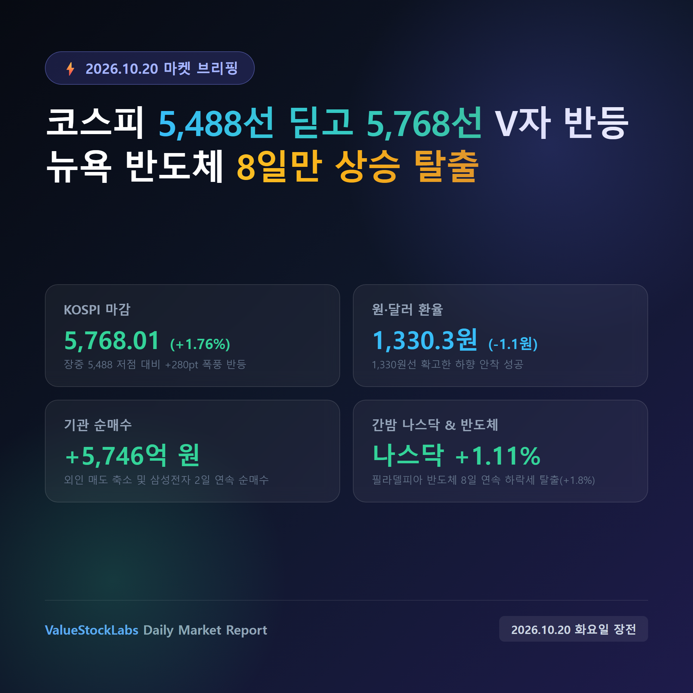
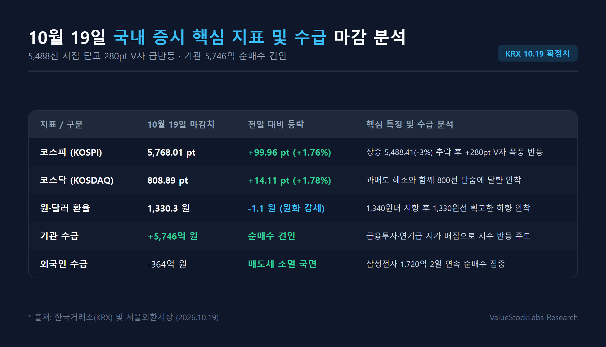
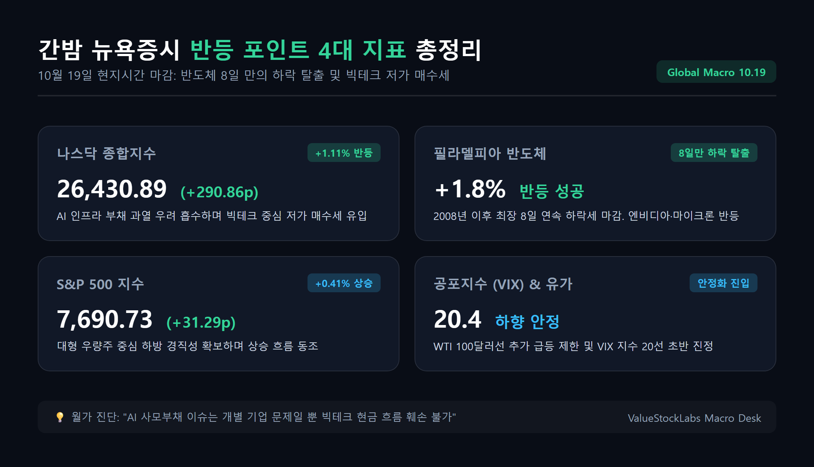
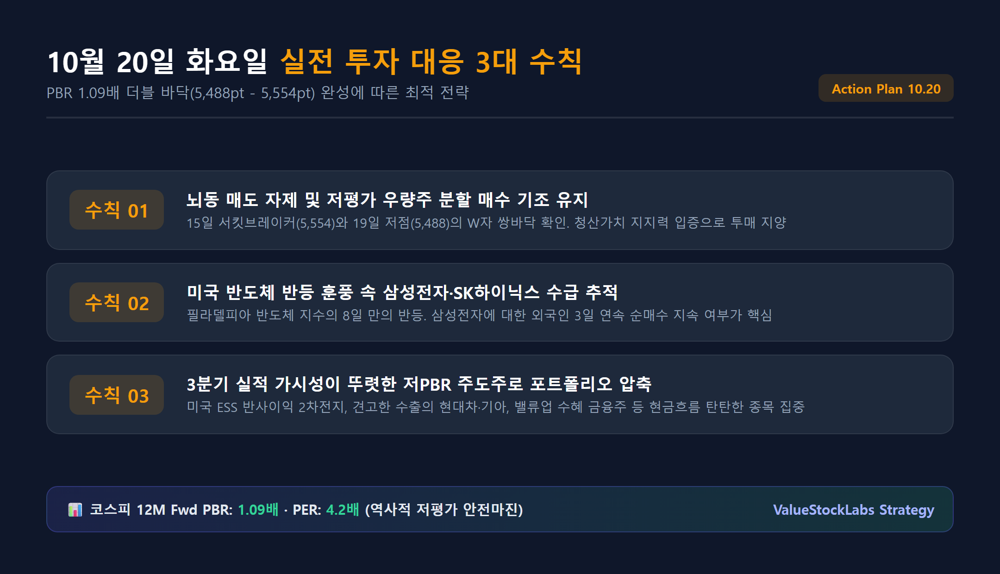

# [오늘의 증시 시황] 코스피 5,488선 딛고 5,768선 V자 반등: 뉴욕 반도체 8일만 상승 속 10월 20일 실전 대응 전략

> 10월 19일 코스피가 장초반 5,488선까지 급락한 뒤 저점 대비 280포인트 폭풍 반등하며 5,768선에 안착했습니다. 간밤 뉴욕증시에서도 나스닥이 +1.11% 반등하고 필라델피아 반도체 지수가 8거래일 만에 상승 반전했습니다. 10월 20일 화요일 개장을 앞두고 핵심 지표와 실전 투자 전략을 총정리합니다.

---

## 목차
- [1. 10월 19일 국내 증시 V자 급반등과 기관 5,700억 순매수의 의미](#1-10월-19일-국내-증시-v자-급반등과-기관-5700억-순매수의-의미)
- [2. 삼성전자 2일 연속 외인 순매수와 2차전지·대형주 랠리 배경](#2-삼성전자-2일-연속-외인-순매수와-2차전지대형주-랠리-배경)
- [3. 간밤 뉴욕 나스닥 +1.11% 및 필라델피아 반도체 8일 만의 하락 탈출](#3-간밤-뉴욕-나스닥-111-및-필라델피아-반도체-8일-만의-하락-탈출)
- [4. 코스피 12M Fwd PBR 1.09배 더블 바닥과 10월 20일 실전 대응 3대 수칙](#4-코스피-12m-fwd-pbr-109배-더블-바닥과-10월-20일-실전-대응-3대-수칙)

---

## 1. 10월 19일 국내 증시 V자 급반등과 기관 5,700억 순매수의 의미

10월 19일(월) 국내 증시는 그야말로 롤러코스터 같은 드라마틱한 반등 드라마를 연출했습니다.

직전 주말 미국발 AI 인프라 부채 회의론과 기술주 급락 여파로 코스피는 개장 직후 3% 넘게 폭락하며 **5,488.41까지 추락**했습니다. 지난 15일 서킷브레이커 저점(5,554.22)마저 하회하자 시장에는 극심한 공포가 번졌습니다.

그러나 5,500선 아래에서 저평가 매력을 감지한 **기관 투자자의 5,746억 원 규모 공격적 순매수**가 유입되면서 시장 분위기는 180도 바뀌었습니다. 지수는 장중 저점 대비 무려 **+280포인트 이상 폭풍 반등**하며 전 거래일 대비 **+99.96포인트(+1.76%) 상승한 5,768.01**로 화려하게 마감했습니다.

코스닥 지수 역시 동반 반등하여 전 거래일 대비 **+14.11포인트(+1.78%) 상승한 808.89**를 기록, 단숨에 800선 고지를 탈환했습니다.

| 시장 지표 | 10월 19일 마감 수치 | 전일 대비 등락률 | 수급 및 시장 특징 |
| :--- | :--- | :--- | :--- |
| **코스피 (KOSPI)** | **5,768.01** | **+1.76% (+99.96p)** | 장초반 5,488선 추락 후 +280pt V자 폭풍 반등 마감 |
| **코스닥 (KOSDAQ)** | **808.89** | **+1.78% (+14.11p)** | 과매도 해소와 함께 800선 단숨에 안착 |
| **원·달러 환율** | **1,330.3원** | **-1.1원 (원화 강세 유지)** | 외환 당국 안정 의지 및 네고 물량 유입으로 1,330원선 안착 |
| **기관 순매수** | **+5,746억 원** | **지수 상승 견인** | 금융투자·연기금 중심 저가 우량주 대거 매집 |
| **외국인 순매도** | **-364억 원** | **매도세 극적 축소** | 지난주 조 단위 투매 대비 매도 압력 사실상 소멸 국면 |
| **개인 순매도** | **-1조 8,620억 원** | **현금화 및 손절** | 급반등 국면에서 비중 축소 및 차익실현 출회 |

서울 외환시장에서 원·달러 환율은 전일 대비 **-1.1원 내린 1,330.3원**으로 마감했습니다. 1,340원대 중반으로 치솟았던 환율이 1,330원선 초반에 하향 안착하면서 시스템적 외환 유출 위험을 확실하게 잠재웠습니다.

---

## 2. 삼성전자 2일 연속 외인 순매수와 2차전지·대형주 랠리 배경

19일 장세에서 가장 돋보인 팩트는 **외국인의 매도세 진정과 삼성전자에 대한 2거래일 연속 순매수**입니다.

외국인은 코스피 전체에서는 364억 원 순매도에 그쳐 지난주 수천억~조 단위 폭풍 매도세가 사실상 멈췄음을 확인시켜 주었습니다. 특히 **삼성전자에 대해 약 1,720억 원의 순매수**를 집중하며, 장 초반 4%대 급락세를 딛고 **+1.16% 상승한 21만 8,000원**으로 반등을 이끌었습니다.

SK하이닉스 역시 장중 5%대 하락을 극복하고 **+0.39% 오른 127만 7,000원**으로 강보합 마감하여 반도체 투톱의 지지력을 확인했습니다.

여기에 섹터별 강력한 호재가 지수 반등을 견인했습니다.

1. **2차전지 섹터의 기록적 폭등**:
   - 중국 에너지저장장치(ESS) 제조사들이 미국 규제에 따라 현지 시장 철수를 결정하면서 국내 배터리 셀 기업들의 천문학적 반사이익이 부각되었습니다.
   - 이에 힘입어 **삼성SDI가 +11.70%**, **LG에너지솔루션이 +7.20%** 급등하며 시장 분위기를 뜨겁게 달궜습니다.
2. **시총 상위 대표주 동반 랠리**:
   - **삼성바이오로직스(+9.94%)**가 대규모 위탁생산 모멘텀으로 폭등했고, 호실적 기대감이 반영된 **현대차(+4.49%)**와 **기아(+5.26%)** 등 자동차 대표주들이 가파르게 상승했습니다.

---

## 3. 간밤 뉴욕 나스닥 +1.11% 및 필라델피아 반도체 8일 만의 하락 탈출

국내 증시의 극적인 V자 반등에 이어, 간밤(10월 19일 현지시간) 뉴욕증시에서도 국내 투자자들이 안도할 만한 강력한 반등 신호가 전달되었습니다.

- **다우존스30 산업평균지수**: 51,966.03 (-36.38p, -0.07%, 보합 혼조)
- **S&P 500 지수**: 7,690.73 (+31.29p, **+0.41%**)
- **나스닥 종합지수**: **26,430.89 (+290.86p, +1.11%)**
- **필라델피아 반도체 지수**: **+1.8%대 상승 반전 (8거래일 연속 하락세 탈출)**

뉴욕증시 반등의 결정적 요인은 두 가지입니다.

첫째, **필라델피아 반도체 지수가 8거래일 만에 상승세로 돌아섰다는 점**입니다. 2008년 글로벌 금융위기 이후 최장기간 이어지던 반도체 섹터의 내림세를 끊어내고 엔비디아, 마이크론, AMD 등이 2~4%대 일제히 반등했습니다.

둘째, **AI 네오클라우드 부채 공포의 과민 반응 인식**입니다. 월가에서는 비상장 GPU 임대 기업들의 사모 부채 리스크가 마이크로소프트, 구글, 메타와 같은 빅테크 기업들의 막강한 현금 창출력과 AI CAPEX 투자를 흔들지 못한다는 평가가 힘을 얻었습니다.

여기에 배럴당 100달러를 돌파했던 국제유가(WTI)가 추가 상승을 멈추고 숨고르기에 들어갔으며, 공포지수(VIX)도 20선 초반으로 내려앉아 글로벌 위험회피 심리가 빠르게 진정되었습니다.

---

## 4. 코스피 12M Fwd PBR 1.09배 더블 바닥과 10월 20일 실전 대응 3대 수칙

10월 20일(화) 오늘 장을 앞둔 코스피 시장의 기술적·펀더멘털 위치는 명확합니다.

### (1) 5,488pt - 5,554pt의 확고한 '이중 바닥(W자 쌍바닥)' 형성
- 15일 서킷브레이커 당시의 5,554선과 19일 시초가 투매 당시의 5,488선은 코스피 **12개월 선행 PBR 1.0배(청산가치)** 영역에 해당합니다.
- 시장은 두 번에 걸친 극단적 투매에도 5,500선 안팎에서 강력한 저가 매수세가 대거 유입되는 것을 확인했습니다.
- 현재 코스피 5,768선 기준 **12개월 선행 PBR은 1.09배**, **PER은 4.2배 수준**으로 역사적인 안전 마진을 여전히 확보하고 있습니다.

### (2) 10월 20일(화) 실전 투자 3대 대응 수칙

1. **뇌동 투매 자제 및 저평가 우량주 분할 매수 유지**:
   - 5,488선에서 확고한 바닥 지지력을 확인했고 미국 증시도 반등에 성공한 만큼, 지수 흔들림에 공포 매도로 대응할 이유가 없습니다.
2. **반도체 지수 반등에 따른 삼성전자·SK하이닉스 수급 추적**:
   - 필라델피아 반도체 지수의 8일 만의 하락 탈출로 외국인의 국내 반도체 투톱 매수 기조가 지속되는지 모니터링해야 합니다. 삼성전자에 대한 외인 순매수가 3일 연속으로 이어지는지가 핵심 분수령입니다.
3. **3분기 실적 가시성이 뚜렷한 저PBR 주도주 압축**:
   - 미국 ESS 수혜가 부각된 2차전지, 견고한 글로벌 판매를 기록 중인 현대차·기아, 밸류업 프로그램 수혜 금융주 등 부채 부담이 적고 현금흐름이 탄탄한 종목으로 포트폴리오를 슬림화·압축해야 합니다.

---

*면책 조항: 본 글은 공개된 신뢰성 있는 금융 데이터를 바탕으로 작성된 정보 제공 목적의 콘텐츠이며, 특정 금융투자상품에 대한 매수·매도 추천이나 확정적 수익을 보장하지 않습니다. 모든 투자에 대한 최종 책임은 투자자 본인에게 있습니다.*
