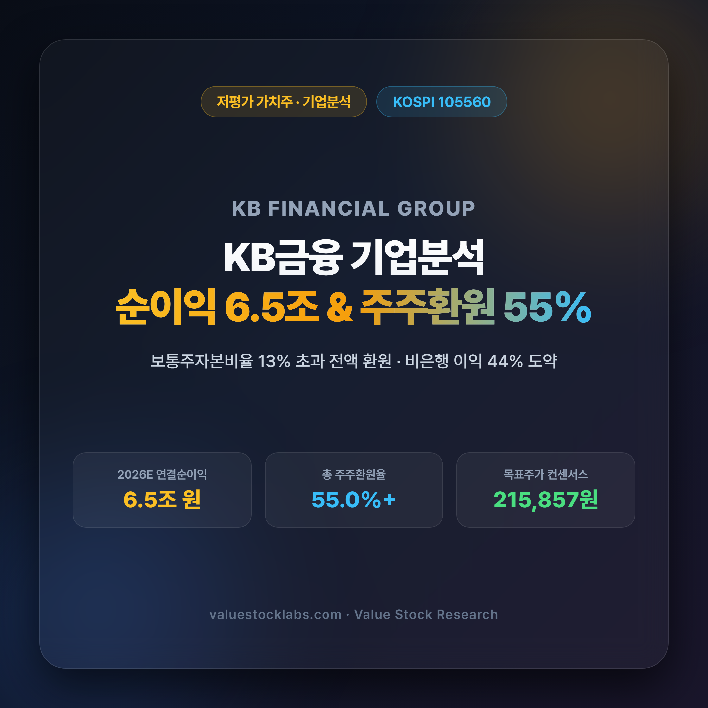
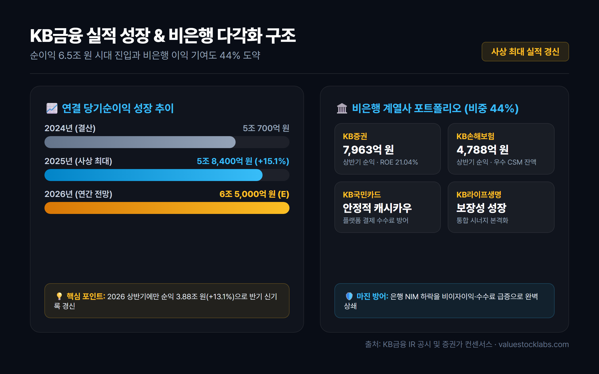
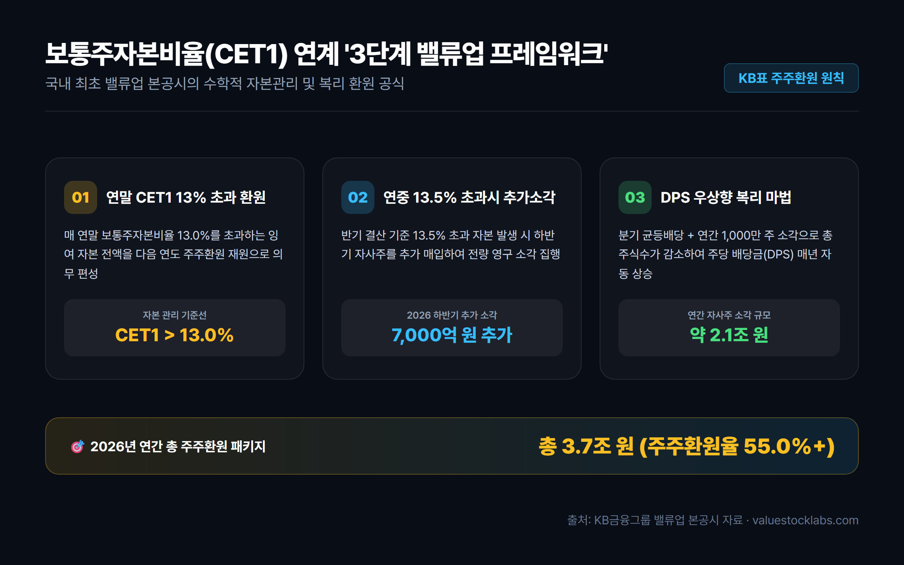
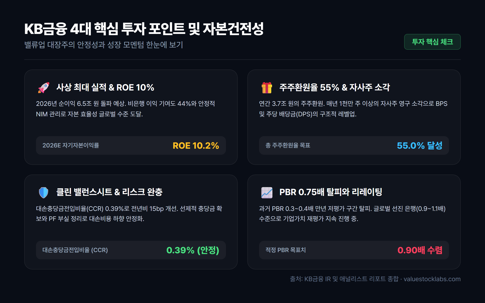
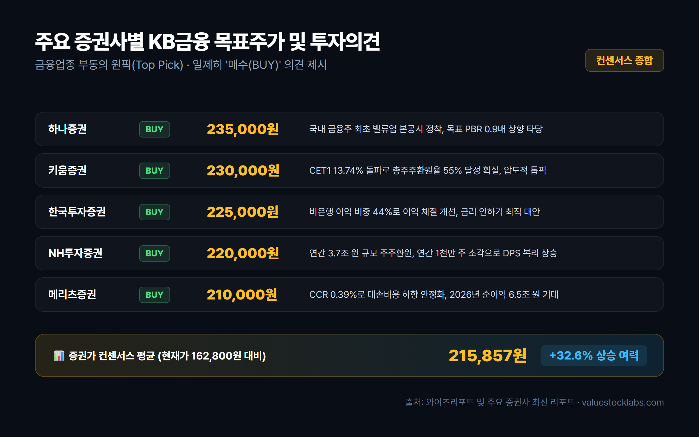

# KB금융 주가 전망과 기업분석: 순이익 6.5조원과 밸류업 주주환원율 55% 총정리

> 사상 최대 실적 경신과 국내 최초 밸류업 본공시를 통해 PBR 리레이팅을 이끄는 대한민국 금융 대장주 KB금융(105560)의 실적, 주주환원율, 보통주자본비율(CET1), 증권가 목표주가를 심층 분석합니다.

---

## 목차
- [1. 서론: 왜 지금 다시 KB금융인가?](#1-서론-왜-지금-다시-kb금융인가)
- [2. 실적 분석: 사상 최대 순이익과 비은행 포트폴리오의 도약](#2-실적-분석-사상-최대-순이익과-비은행-포트폴리오의-도약)
- [3. 밸류업의 핵심: 보통주자본비율(CET1) 연계 주주환원 프레임워크](#3-밸류업의-핵심-보통주자본비율cet1-연계-주주환원-프레임워크)
- [4. 자산건전성 및 밸류에이션: PBR 0.7배 돌파와 리레이팅 가능성](#4-자산건전성-및-밸류에이션-pbr-07배-돌파와-리레이팅-가능성)
- [5. 투자 시 반드시 짚어야 할 3대 리스크 요인](#5-투자-시-반드시-짚어야-할-3대-리스크-요인)
- [6. 증권사별 목표주가 및 투자 결론](#6-증권사별-목표주가-및-투자-결론)

---

## 1. 서론: 왜 지금 다시 KB금융인가?

국내 증시에서 오랜 기간 동안 은행주는 '수익성은 좋지만 주가는 움직이지 않는 만년 저평가(Value Trap)'의 대명사로 불려왔습니다. 주가순자산비율(PBR) 0.3~0.4배 수준에 머무르며 심각한 코리아 디스카운트를 겪었던 은행주 섹터의 패러다임이 2024년 정부의 '기업 밸류업 프로그램' 도입과 금융사들의 주주친화적 자본배치 정책 전환을 기점으로 근본적으로 바뀌고 있습니다.

그 중심에 서 있는 절대적인 리더가 바로 **KB금융(105560)**입니다. KB금융은 국내 상장 금융지주사 중 최초로 명확하고 정교한 **밸류업 본공시**를 단행하며 글로벌 스탠더드에 부합하는 주주환원 프레임워크를 시장에 공표했습니다. 단순한 구호에 그치지 않고 사상 최대 실적 행진과 분기 균등배당, 연간 1조 원 이상의 자사주 매입·소각을 동반하며 주주가치 제고를 행동으로 증명하고 있습니다.

2026년 기준 주가 16만 원대, 시가총액 58조 원을 넘어서며 코스피 최상위권의 위상을 확고히 한 KB금융이 과연 추가적인 밸류에이션 리레이팅(Re-rating)을 통해 주가 20만 원 고지에 안착할 수 있을지, 핵심 실적과 자본 구조, 주주환원 지표를 하나씩 살펴보겠습니다.

---

## 2. 실적 분석: 사상 최대 순이익과 비은행 포트폴리오의 도약

KB금융의 가장 큰 강점은 경기 변동과 금리 변동성에 흔들리지 않는 **강력하고 다변화된 이익 체력**입니다.

### ① 2025~2026년 실적 성장 추이
KB금융은 2025년 연결 당기순이익 **5조 8,400억 원**(전년 대비 +15.1%)을 기록하며 창사 이래 최대 실적을 달성했습니다. 과거 은행 실적의 발목을 잡았던 홍콩 H지수 ELS 손실 배상 등 일회성 비용 요인이 완벽히 소멸되었고, 이자이익과 비이자이익이 고르게 성장한 결과입니다.

성장세는 2026년에도 이어지고 있습니다. 2026년 상반기에만 누적 순이익 **3조 8,846억 원**(+13.1% YoY)을 달성하여 반기 기준 사상 최대 실적을 새롭게 갈아치웠으며, 연간 순이익 컨센서스는 **6조 5,000억 원** 수준으로 상향 조정되고 있습니다.

### ② 비은행 계열사의 약진 (이익 기여도 44%)
시중은행 중심의 타 금융지주들과 달리 KB금융은 비은행 부문에서 독보적인 경쟁력을 갖추고 있습니다. 2026년 상반기 기준 그룹 전체 당기순이익 중 비은행 계열사가 차지하는 비중은 **44%**에 달합니다.

- **KB증권**: 자본시장 활황과 WM(자산관리), IB 수수료 수익 확대로 상반기 순이익 7,963억 원(ROE 21.04%)을 창출하며 그룹 전체 순이익의 21%를 견인했습니다.
- **KB손해보험**: IFRS17 회계기준 도입 이후 우수한 CSM(계약서비스마진) 잔액을 기반으로 상반기 4,788억 원의 안정적인 순익을 더했습니다.
- **KB국민카드 및 KB라이프생명**: 결제 수수료 방어와 보장성 보험 신계약 확대로 탄탄한 현금흐름을 창출하고 있습니다.

| 구분 | 2024년 (결산) | 2025년 (결산) | 2026년 상반기 (실적) | 2026년 연간 (E) |
|---|:---:|:---:|:---:|:---:|
| **연결 당기순이익** | 약 5.07조 원 | **5.84조 원** | **3.88조 원** | **약 6.50조 원** |
| **비은행 이익 비중** | 38.6% | 40.2% | **44.0%** | **43~45%** |
| **그룹 NIM (순이자마진)** | 2.05% | 1.98% | **1.94%** | **1.92~1.94%** |
| **그룹 ROE (자기자본이익률)** | 9.1% | 9.6% | **10.2%** | **9.8~10.0%** |
| **비용효율성 (CIR)** | 38.4% | 37.1% | **36.2%** | **36.0% 안팎** |

한국은행의 기준금리 인하 기조 속에서 은행 NIM(순이자마진)이 소폭 하락(상반기 국민은행 NIM 1.74%)했음에도 불구하고, 비은행 수수료 수익과 채권 트레이딩 이익이 이자이익 감소분을 초과 달성하며 그룹 전체 이익 레벨을 한 단계 끌어올렸습니다.

---

## 3. 밸류업의 핵심: 보통주자본비율(CET1) 연계 주주환원 프레임워크

KB금융 주가 상승의 가장 직접적인 기폭제는 바로 시장의 신뢰를 얻은 **정교한 주주환원 메커니즘**입니다. 과거 은행들은 경영진의 재량에 따라 배당금을 들쭉날쭉 지급했으나, KB금융은 국내 최초로 수학적 공식에 가까운 '자본관리 프레임워크'를 본공시했습니다.

### ① 3단계 주주환원 작동 원리
1. **연말 CET1 비율 13.0% 초과 자본 전액 환원**:
   - 매년 말 기준 바젤III 보통주자본비율(CET1)이 13.0%를 초과할 경우, 초과분 전액을 다음 해 연간 주주환원(현금배당 + 자사주 매입·소각) 재원으로 의무 투입합니다.
2. **연중 CET1 비율 13.5% 초과 시 하반기 추가 자사주 매입·소각**:
   - 반기 실적 발표 시점에서 CET1 비율이 13.5%를 넘어설 경우, 위험가중자산(RWA) 성장을 감안한 잉여 자본으로 하반기 자사주를 추가 매입하여 전량 소각합니다. 2026년 상반기 말 CET1 비율은 **13.74%**를 기록하여 하반기 7,000억 원의 추가 소각이 즉각 발표되었습니다.
3. **분기 균등배당과 주당배당금(DPS) 우상향의 복리 마법**:
   - 연간 배당총액을 고정하거나 늘린 상태에서 매년 약 1,000만 주 이상의 자사주를 영구 소각함에 따라, 전체 발행주식 수가 줄어들어 주주가 손에 쥐는 **주당 배당금(DPS)은 실적 변동과 무관하게 구조적으로 매년 우상향**하게 됩니다.

### ② 주주환원율 및 환원 규모 추이
| 연도 | 보통주자본비율(CET1) | 현금배당 총액 | 자사주 매입/소각 | 총 주주환원액 | **총 주주환원율** |
|---|:---:|:---:|:---:|:---:|:---:|
| **2023년** | 13.58% | 1.16조 원 | 0.57조 원 | 1.73조 원 | **37.5%** |
| **2024년** | 13.60% | 1.25조 원 | 0.82조 원 | 2.07조 원 | **40.8%** |
| **2025년** | 13.67% | 1.45조 원 | 1.60조 원 | 3.05조 원 | **52.4%** |
| **2026년 (E)** | **13.74%** | **약 1.60조 원** | **약 2.10조 원** | **약 3.70조 원** | **55.0% 이상** |

2025년 기준 총주주환원율 52.4%를 달성한 데 이어, 2026년에는 연간 3조 7,000억 원에 달하는 환원 규모를 바탕으로 **주주환원율 55% 돌파**가 확실시되고 있습니다. 이는 미국이나 유럽의 톱티어 글로벌 은행들과 어깨를 나란히 하는 수준입니다.

---

## 4. 자산건전성 및 밸류에이션: PBR 0.7배 돌파와 리레이팅 가능성

### ① 대손충당금 안정화와 건전성 방어
주주환원율을 끌어올릴 수 있는 근원적인 배경에는 안정적인 자산 건전성이 있습니다.
- **대손충당금전입비율(CCR)**: 2026년 상반기 그룹 CCR은 **0.39%**로, 전년 동기 대비 약 15bp 큰 폭 개선되었습니다. 2023~2024년 동안 부동산 PF 및 고금리 취약 차주에 대해 4조 원 이상의 충당금을 보수적으로 쌓아둔 덕분에 추가 부실 전입 부담이 대폭 낮아졌습니다.
- **고정이하여신(NPL) 비율**: KB국민은행의 NPL 비율은 **0.34%**로 업계 최저 수준을 유지 중이며, 부실 우려 부동산 PF 익스포저는 엄격한 금융당국 가이드라인 하에 이미 대손 상각 및 매각 처리를 마무리했습니다.

### ② PBR 리레이팅과 글로벌 피어 비교
현재 KB금융의 12개월 선행 PBR은 **약 0.72~0.78배**, PER은 **약 8.2~8.8배** 수준에서 거래되고 있습니다.
- 과거 0.3~0.4배에 머물던 극단적 저평가 국면은 벗어났지만, 여전히 JP모건(PBR 1.8배), 웰스파고(1.3배), 일본 미쓰비시UFJ(0.9~1.0배) 등 해외 선진국 금융주와 비교하면 여전히 할인 폭이 큽니다.
- 연간 순이익 6.5조 원, ROE 10% 유지, 주주환원율 55%라는 실질적 지표를 고려할 때, 시장 전문가들은 KB금융의 적정 PBR이 **0.9배 이상**으로 수렴해야 한다고 평가합니다.

---

## 5. 투자 시 반드시 짚어야 할 3대 리스크 요인

투자자라면 낙관적인 전망 이면에 자리 잡은 잠재적 위험 요인도 면밀히 점검해야 합니다.

1. **기준금리 추가 인하와 은행 이자이익 둔화 압력**:
   - 한국은행의 추가 금리 인하 사이클이 본격화될 경우 대출금리 하락으로 인한 은행 NIM 압박이 심화될 수 있습니다. 비은행 수수료 이익이 이를 얼마나 지속적으로 방어할 수 있을지가 핵심 관전 포인트입니다.
2. **정부의 가계대출 총량 규제 및 스트레스 DSR 확대**:
   - 수도권 집값 안정화를 위한 대출 규제 강화로 주택담보대출 성장률이 둔화될 수 있습니다. 대기업 및 우량 중소기업 대출 중심의 성장 전략이 요구됩니다.
3. **금융권 사회적 책임 요구와 상생금융 비용**:
   - 사상 최대 실적 발표 시마다 불거지는 횡재세 논란이나 상생금융 출연 압박 등 정책적 규제 리스크가 잔존합니다.

---

## 6. 증권사별 목표주가 및 투자 결론

국내 주요 증권사들은 KB금융에 대해 일제히 **'매수(BUY)'** 투자의견을 제시하며 금융업종 내 부동의 **최선호주(Top Pick)**로 꼽고 있습니다.

| 증권사 | 투자의견 | 목표주가 (원) | 핵심 투자 포인트 요약 |
|---|:---:|:---:|---|
| **하나증권** | BUY | **235,000** | 국내 금융주 최초 밸류업 본공시 정착, 목표 PBR 0.9배 상향 타당 |
| **키움증권** | BUY | **230,000** | CET1 13.74% 돌파로 총주주환원율 55% 달성 확실, 압도적 톱픽 |
| **한국투자증권** | BUY | **225,000** | 비은행 이익 비중 44%로 이익 체질 개선, 금리 인하기 최적 대안 |
| **NH투자증권** | BUY | **220,000** | 연간 3.7조 원 규모 주주환원, 연간 1천만 주 소각으로 DPS 복리 상승 |
| **메리츠증권** | BUY | **210,000** | CCR 0.39%로 대손비용 하향 안정화, 2026년 순이익 6.5조 원 기대 |
| **컨센서스 평균** | **BUY** | **215,857** | **현재 주가(162,800원) 대비 약 +32.6% 상승 여력 제시** |

### 💡 투자 총평
KB금융은 단순한 고배당 금융주를 넘어, **'사상 최대 실적 + 연간 주주환원율 55% + 자사주 영구 소각 + 비은행 포트폴리오 다각화'**라는 4박자를 완벽하게 갖춘 대한민국 대표 가치성장주로 진화했습니다. 

금리 인하 사이클 진입에도 불구하고 견고한 비이자이익과 철저한 리스크 관리, 그리고 13%를 초과하는 자본을 아낌없이 주주에게 돌려주는 예측 가능한 자본정책은 중장기 가치투자자에게 가장 매력적인 투자 기회를 제공합니다.

---

*면책 조항: 본 분석 글은 공개된 공시 자료 및 증권사 리포트를 기반으로 정보 제공을 위해 작성되었으며, 특정 금융상품에 대한 투자 권유나 매수 추천이 아닙니다. 모든 투자의 최종 결정과 책임은 투자자 본인에게 있습니다.*

---

## 7. 참고 출처 (References)
1. [KB금융그룹 공식 IR 및 기업가치 제고 계획(밸류업) 공시](https://www.kbfg.com/kor/ir/notice/list.do)
2. [키움증권 리서치센터: KB금융 밸류업 선봉장 기업분석](https://www.kiwoom.com/h/invest/research/VMarketResearchView)
3. [한국경제 마켓: KB금융 2025-2026 실적 및 비은행 계열사 기여도 분석](https://www.hankyung.com/finance)
4. [이데일리 증권: 보통주자본비율(CET1) 13.7% 돌파 및 하반기 자사주 소각 세부 내역](https://www.edaily.co.kr/news/politics)
5. [와이즈리포트(WiseReport): 국내 증권사 목표주가 컨센서스 및 투자의견 집계](https://www.wisereport.co.kr)
