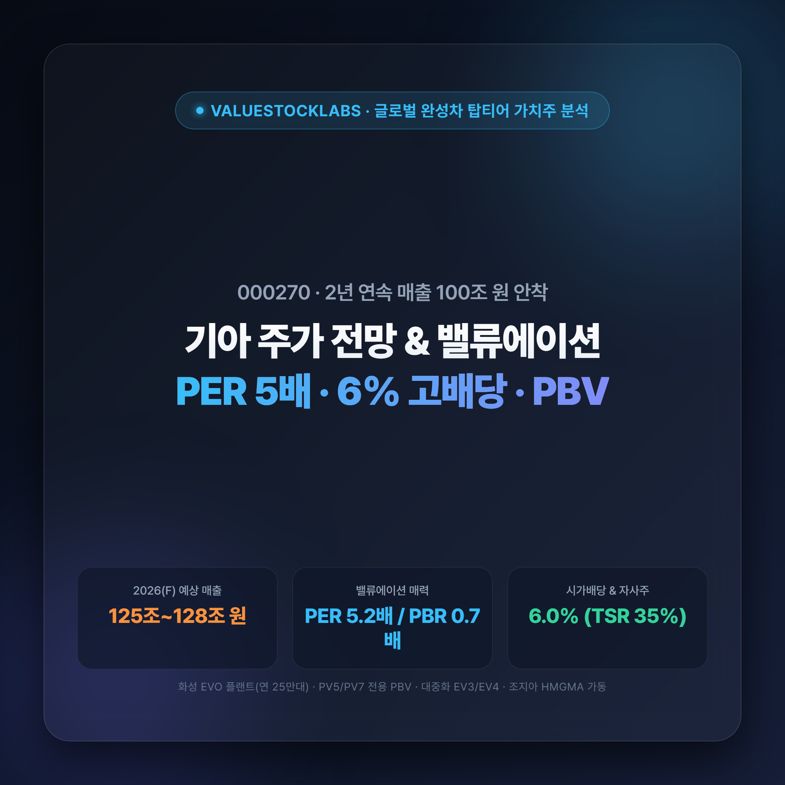
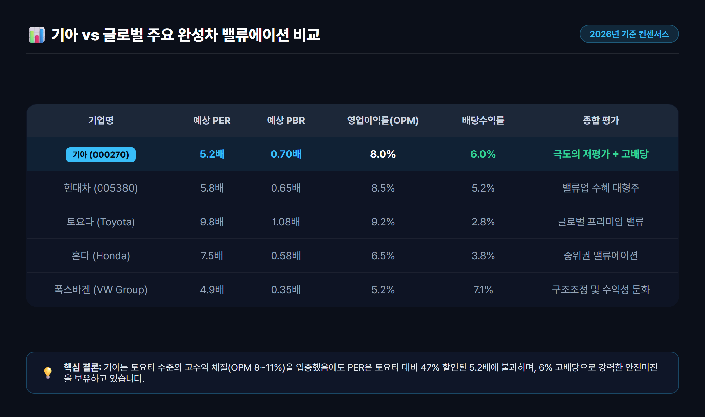
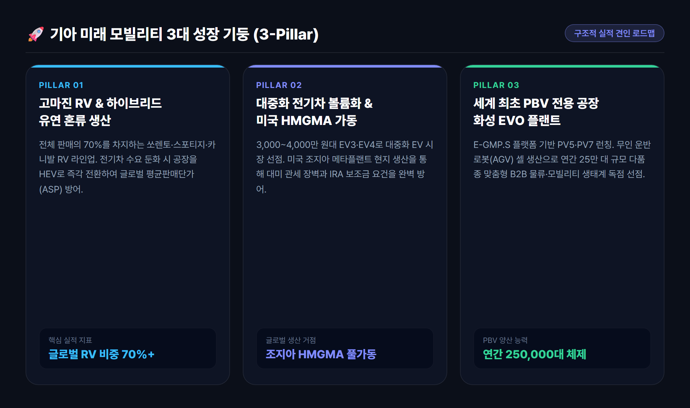
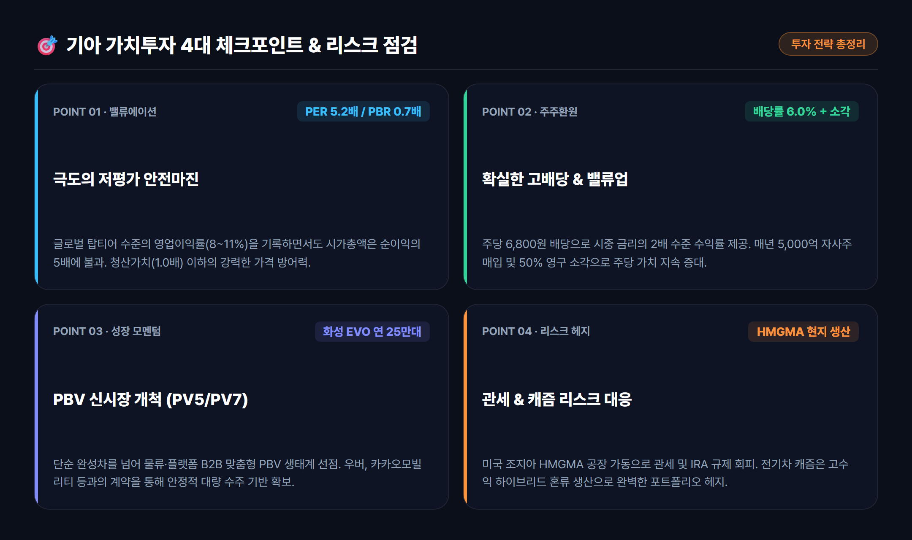

# 기아 주가 전망 기업분석: PER 5배 극저평가와 6% 고배당·PBV 신사업 가치 총정리(000270)

> 창사 이래 2년 연속 매출 100조 원대를 돌파하며 글로벌 최고 수준의 영업이익률을 기록 중인 기아(000270). PER 5배대와 PBR 0.7배라는 압도적 저평가 매력, 6%에 달하는 시가배당률과 화성 EVO 플랜트 중심의 PBV 신성장 동력을 종합 분석합니다.

---

## 목차
- [1. 왜 지금 기아(000270)에 주목해야 하는가?](#sec-1)
- [2. 핵심 실적과 밸류에이션 분석: PER 5배·PBR 0.7배의 안전마진](#sec-2)
- [3. 기아의 3대 핵심 성장 동력과 경제적 해자](#sec-3)
- [4. 밸류업 프로그램과 강력한 주주환원: 배당률 6%와 자사주 소각](#sec-4)
- [5. 투자 전 필수 점검: 3대 리스크 요인과 사전 부검(Pre-Mortem)](#sec-5)
- [6. 결론 및 종합 투자 인사이트](#sec-6)

---

## 1. 왜 지금 기아(000270)에 주목해야 하는가?

글로벌 자동차 산업은 내연기관에서 전동화로 넘어가는 격변기 속에서 **'전기차 캐즘(Chasm, 일시적 수요 둔화)'**과 **'글로벌 보호무역 관세 리스크'**라는 복합적 도전에 직면해 있습니다. 

그러나 이러한 혼돈의 국면에서 전 세계 완성차 제조사 중 가장 탁월한 유연성과 압도적인 수익성을 증명하고 있는 기업이 바로 **기아(000270)**입니다.

과거 저가차 이미지에서 벗어나 텔루라이드, 쏘렌토, 스포티지, 카니발 등 고부가가치 레저용 차량(RV) 중심의 라인업을 완성한 기아는 2024년 창사 이래 최초로 매출 107조 원, 영업이익 12.6조 원을 달성하며 역사적 신고가를 경신했습니다. 이어 2025년에도 매출 114조 원을 기록하여 **2년 연속 '매출 100조 원 클럽'**에 성공적으로 안착했습니다.

그럼에도 불구하고 주식 시장에서 기아의 밸류에이션은 여전히 **PER 5배 안팎, PBR 0.7배 수준**에 갇혀 있습니다. 

단순히 실적만 좋은 것이 아니라, 연간 시가배당률이 6%에 육박하고 5,000억 원 규모의 자사주 매입·소각을 동반하는 밸류업 선도 기업이라는 점을 감안할 때, 현 주가 수준은 가치투자자 관점에서 매우 매력적인 안전마진(Margin of Safety)을 제공하고 있습니다.

---

## 2. 핵심 실적과 밸류에이션 분석: PER 5배·PBR 0.7배의 안전마진

기아의 최근 3개년 실적 지표와 2026년 이후 컨센서스를 살펴보면, 실적의 일회성 피크아웃 우려와 달리 견고한 기초 체력(Fundamental)이 유지되고 있음을 명확히 확인할 수 있습니다.

### 기아 연간 재무 실적 및 컨센서스 추이 (연결 기준)
*(출처: DART 전자공시시스템 및 금융투자업계 컨센서스 집계)*

| 평가 지표 | 2024년 (확정) | 2025년 (확정) | 2026년 (컨센서스 전망) | 평가 및 의미 |
| :--- | :---: | :---: | :---: | :--- |
| **매출액** | **107조 4,488억 원** | **114조 1,409억 원** | **125.4조 ~ 128.7조 원** | 연평균 외형 성장 지속, 100조 원대 견고 |
| **영업이익** | **12조 6,671억 원** | **9조 0,781억 원** | **9.8조 ~ 10.1조 원** | 2025년 조정 후 2026년 10조 원대 재탈환 |
| **영업이익률(OPM)** | **11.8%** | **8.0%** | **7.8% ~ 8.0%** | 글로벌 업계 평균(5~7%)을 상회하는 마진 |
| **당기순이익** | **9조 7,732억 원** | **7조 5,610억 원** | **8.04조 ~ 8.42조 원** | 순이익 8조 원대의 탄탄한 현금 창출력 |
| **ROE(자기자본이익률)** | **23.5%** | **15.8%** | **15.2% ~ 16.0%** | 고수익 제조업의 탁월한 자본 효율성 |
| **PER (주가수익비율)** | **4.6배** | **5.8배** | **5.2배 ~ 5.5배** | 코스피 및 글로벌 완성차 대비 50% 할인 |
| **PBR (주가순자산비율)** | **0.82배** | **0.72배** | **0.68배 ~ 0.70배** | 청산가치(1.0배)에도 미치지 못하는 극저평가 |
| **주당배당금(DPS)** | **5,600원** | **6,800원** | **6,800원 ~ 7,000원** | 배당금 상향 기조 지속 |
| **시가배당수익률** | **5.2%** | **6.0%** | **5.8% ~ 6.1%** | 시중 금리를 압도하는 고배당 하방 경직성 |

### 밸류에이션 정상화 관점에서의 시사점
1. **글로벌 피어(Peer) 대비 현저한 저평가**: 토요타(PER 9~10배, PBR 1.0~1.1배), 혼다(PER 7~8배) 등 일본계 경쟁사와 비교했을 때 기아의 PER 5.2배, PBR 0.7배는 기업의 질적 성장을 반영하지 못한 명백한 디스카운트 구간입니다.
2. **이익의 질(Quality of Earnings)**: 기아의 순이익 대부분은 감가상각비를 제외한 실제 영업현금흐름(OCF)으로 유입되고 있으며, 풍부한 잉여현금흐름(FCF)은 고스란히 배당 확대와 차세대 PBV 연구개발로 재투자되고 있습니다.

---

## 3. 기아의 3대 핵심 성장 동력과 경제적 해자

기아가 EV 캐즘 속에서도 흔들리지 않고 고수익을 유지할 수 있는 비결은 탄탄한 포트폴리오와 미래 모빌리티를 선점하는 3대 핵심 성장 축에 있습니다.

### ① 고마진 RV와 하이브리드(HEV) 유연 혼류 생산 체제
- **RV 판매 비중 70% 돌파**: 스포티지, 쏘렌토, 카니발, 텔루라이드 등 고부가가치 레저용 차량의 글로벌 판매 비중이 70%를 넘어서며 대당 평균판매가격(ASP) 상승을 이끌고 있습니다.
- **민첩한 하이브리드 대응**: 전기차 수요가 일시적으로 정체되자, 기아는 공장 라인을 즉시 하이브리드 혼류 생산으로 전환하여 대기 수요를 흡수했습니다. 특히 쏘렌토 HEV와 카니발 HEV는 출고 대기가 수개월에 달할 만큼 북미와 국내에서 독보적인 인기를 유지하고 있습니다.

### ② 대중화 전기차(EV3, EV4)와 글로벌 현지 생산(HMGMA)
- **전기차 대중화 선도**: 기아는 E-GMP 기반의 플래그십(EV6, EV9) 성공에 안주하지 않고, 3,000만~4,000만 원대의 매력적인 가격대를 갖춘 소형 전동화 SUV **EV3**와 전동화 세단 **EV4**를 전격 출시했습니다. 유럽 및 신흥 시장에서 가성비와 기술력을 인정받으며 전동화 점유율을 가파르게 끌어올리고 있습니다.
- **미국 조지아 HMGMA 가동**: 현대차그룹 메타플랜트 아메리카(HMGMA)의 본격 가동으로 미국 인플레이션 감축법(IRA) 보조금 요건을 완벽히 충족하며, 잠재적 수입차 관세 리스크를 현지 생산으로 정면 돌파할 수 있는 강력한 교두보를 마련했습니다.

### ③ 목적기반 모빌리티(PBV)의 글로벌 독점적 지위
- **화성 EVO 플랜트(세계 최초 PBV 전용 스마트팩토리)**: 컨베이어 벨트와 무인 운반 로봇(AGV) 기반의 셀(Cell) 유연 생산을 결합하여 연간 20만~25만 대 규모의 다품종 맞춤형 PBV 양산 체제를 구축했습니다.
- **PV5 및 PV7 라인업**: 전용 플랫폼 `E-GMP.S`를 적용한 중형 PBV `PV5`(카고·패신저·WAV)를 시작으로, 우버, 카카오모빌리티, 글로벌 물류사(DHL 등)와의 B2B 협력을 통해 소프트웨어 중심 모빌리티(SDV) 시장의 표준을 선점하고 있습니다.

---

## 4. 밸류업 프로그램과 강력한 주주환원: 배당률 6%와 자사주 소각

국내 상장사 중 기아만큼 주주환원에 진심인 대형주는 드뭅니다. 정부의 기업 밸류업 프로그램 발표 이전부터 기아는 선제적이고 투명한 주주환원 정책을 발표하고 충실히 이행해 왔습니다.

### 1. 시가배당률 약 6%의 초고배당 매력
- 주당 배당금(DPS)은 2024년 5,600원에서 2025년 6,800원으로 가파르게 인상되었습니다.
- 현재 주가(11만 원대 초반) 기준 **연간 배당수익률은 약 5.8% ~ 6.0%**에 달합니다. 이는 웬만한 배당주 펀드나 금융지주사 수준의 배당률로, 주가가 일정 수준 이하로 하락할 때마다 강력한 배당락 전후 저가 매수세가 유입되는 든든한 안전판입니다.

### 2. 연간 5,000억 원 자사주 매입 및 50% 이상 즉각 소각
- 기아는 매년 5,000억 원 규모의 자기주식을 장내 매수하고, 이 중 50% 이상을 영구 소각함으로써 유통 주식 수를 지속적으로 줄여나가고 있습니다.
- 이는 주당순이익(EPS)과 주당순자산(BPS)을 구조적으로 끌어올리는 효과를 낳으며, 중장기 목표 총주주환원율(TSR) 35%를 조기 달성하는 결정적 밑거름이 되고 있습니다.

---

## 5. 투자 전 필수 점검: 3대 리스크 요인과 사전 부검(Pre-Mortem)

워런 버핏과 찰리 멍거의 격언처럼, 뛰어난 투자자는 장밋빛 전망에 앞서 **"이 투자가 실패한다면 그 이유는 무엇인가?"**를 먼저 점검해야 합니다.

| 구분 | 주요 리스크 요인 | 상세 내용 및 파급 영향 | 기아의 대응 방안 및 안전마진 |
| :---: | :--- | :--- | :--- |
| **리스크 1** | **미국 무역관세 장벽** | 미 행정부의 보편관세 부과 시 대미 완성차 수출 마진 압박 가능성 | 조지아 HMGMA 현지 생산 비중 극대화 및 멕시코 공장 활용을 통한 관세 영향 최소화 |
| **리스크 2** | **글로벌 인센티브 경쟁** | 테슬라·BYD의 전기차 가격 인하 및 미국 딜러 인센티브 증가에 따른 판관비 상승 | 쏘렌토·스포티지 등 높은 잔존가치와 고품질 브랜드력(J.D. Power 1위)을 바탕으로 한 가격 방어 |
| **리스크 3** | **원/달러 환율 변동성** | 원화 강세(환율 하락) 시 원화 환산 수출 실적 및 이익률 일시적 둔화 | 해외 현지 조달 및 결제 비중 확대로 환노출 헤지 완료 |

---

## 6. 결론 및 종합 투자 인사이트

기아(000270)는 단순한 저평가 가치주를 넘어, **"호실적 체력 + 고배당 안전마진 + PBV 성장 스토리"**의 3박자를 모두 갖춘 보기 드문 복합 우량주입니다.

- **안전마진**: PER 5.2배와 PBR 0.7배라는 극단적인 저평가 밸류에이션, 그리고 주가를 단단하게 떠받치는 6%의 시가배당률이 하방 위험을 철저히 차단합니다.
- **상방 모멘텀**: 하이브리드(HEV) 중심의 캐시카우 창출과 함께, 2026년부터 본격화되는 화성 EVO 플랜트의 PBV(PV5) 양산과 HMGMA 현지화 생산 효과가 밸류에이션 리레이팅(Re-rating)의 기폭제로 작용할 것입니다.

단기적인 환율과 관세 노이즈로 주가가 조정을 받을 때마다, 배당 수익과 본질 가치 회복을 기대하며 긴 호흡으로 분할 접근하기에 가장 적합한 종목 중 하나로 판단됩니다.

---

*면책 조항: 본 분석 글은 공시 자료 및 신뢰할 수 있는 금융 시장 정보를 바탕으로 작성된 리서치 콘텐츠이며, 특정 종목에 대한 매수·매도 추천이나 금융 투자 권유가 아닙니다. 모든 투자의 최종 결정과 손익 책임은 투자자 본인에게 있습니다.*

### 참고 출처 (References)
1. [금융감독원 전자공시시스템(DART)](https://dart.fss.or.kr) - 기아 사업보고서 및 밸류업 공시
2. [기아 공식 IR (Kia Investor Relations)](https://www.kia.com) - CEO 인베스터 데이 중장기 전략 및 PBV 로드맵
3. [와이즈리포트 (WiseReport)](https://www.wisereport.co.kr) - 기아 연간 재무제표 및 2026년 증권사 컨센서스
4. [알파스퀘어 (AlphaSquare)](https://alphasquare.co.kr) - 기아 투자 지표(PER, PBR, 배당수익률)
5. [현대자동차그룹 HMG 저널](https://www.hyundaimotorgroup.com) - E-GMP.S 플랫폼 및 화성 EVO 플랜트 기술 분석
