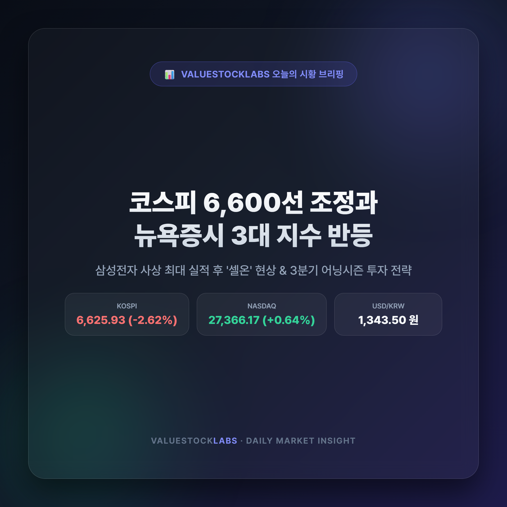
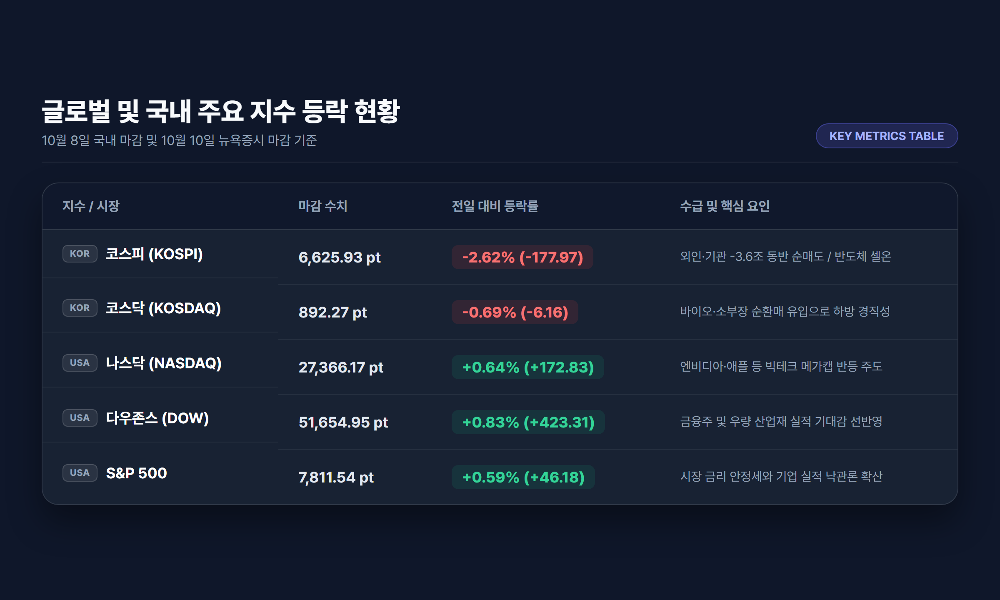
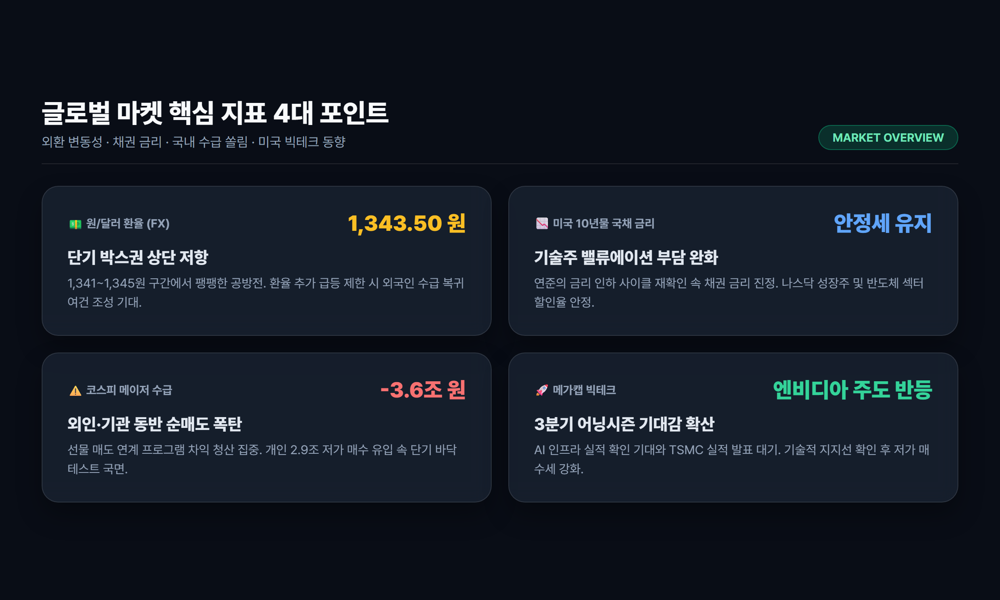
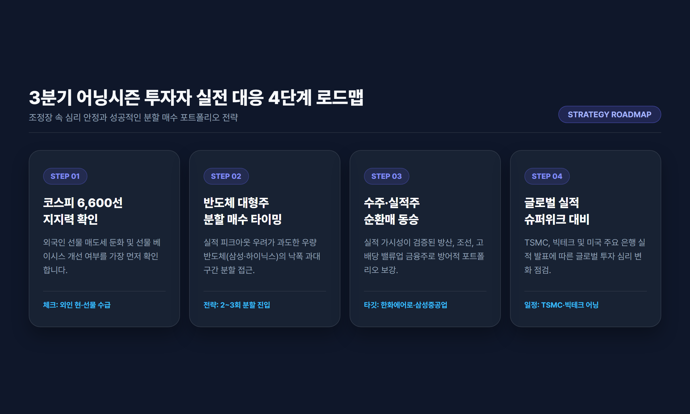

# 오늘의 증시 시황: 코스피 6,600선 조정과 뉴욕증시 반등, 3분기 어닝시즌 투자 전략

> 코스피가 외국인과 기관의 3.6조 원대 동반 순매도에 밀려 6,625선으로 후퇴한 반면, 뉴욕증시는 기술주를 중심으로 3대 지수가 일제히 반등했습니다. 삼성전자 사상 최대 실적 발표 직후 나타난 '셀온(Sell-on)' 현상과 3분기 어닝시즌을 맞이한 주도주 순환매 대응 전략을 종합 점검합니다.

---

## 목차
- [1. 국내 증시 마감: 코스피 6,600선 후퇴와 외인·기관 3.6조 매도 폭탄](#1-국내-증시-마감-코스피-6600선-후퇴와-외인기관-36조-매도-폭탄)
- [2. 뉴욕 증시 3대 지수 반등: 빅테크 지지력과 매크로 금리 환경](#2-뉴욕-증시-3대-지수-반등-빅테크-지지력과-매크로-금리-환경)
- [3. 삼성전자 실적 신기록과 '셀온(Sell-on)': 반도체 vs 순환매 섹터 분석](#3-삼성전자-실적-신기록과-셀온sell-on-반도체-vs-순환매-섹터-분석)
- [4. 다음 주 증시 캘린더와 실전 투자자 대응 로드맵](#4-다음-주-증시-캘린더와-실전-투자자-대응-로드맵)
- [5. 결론 및 요약](#5-결론-및-요약)

---

## 1. 국내 증시 마감: 코스피 6,600선 후퇴와 외인·기관 3.6조 매도 폭탄

국내 증시가 대형 반도체주의 실적 이벤트 이후 거센 차익실현 매물 압박을 받으며 숨고르기 장세에 진입했습니다. 코스피 지수는 전 거래일 대비 177.97포인트(-2.62%) 급락한 **6,625.93포인트**로 거래를 마감했으며, 코스닥 지수 역시 6.16포인트(-0.69%) 하락한 **892.27포인트**를 기록했습니다.

장 초반 6,750선 회복을 시도하던 코스피는 외국인과 기관의 매도세가 걷잡을 수 없이 확대되면서 장중 저점 부근까지 밀려났습니다.

### 시장 참여자별 수급 구조 분석
이번 하락의 가장 직접적인 도화선은 외국인과 기관의 강력한 동반 순매도였습니다. 외국인은 유가증권시장에서 **1조 9,885억 원**, 기관은 **1조 6,714억 원**을 각각 순매도하여 합산 3조 6,000억 원이 넘는 매도 폭탄을 쏟아냈습니다.

| 시장 구분 | 코스피 (KOSPI) | 코스닥 (KOSDAQ) | 비고 |
|---|---|---|---|
| **종가** | 6,625.93 pt | 892.27 pt | 지수 조정 |
| **전일 대비** | -177.97 pt (-2.62%) | -6.16 pt (-0.69%) | 코스피 낙폭 심화 |
| **외국인 수급** | -1조 9,885억 원 | -850억 원 | 전기전자 대량 매도 |
| **기관 수급** | -1조 6,714억 원 | -1,230억 원 | 금융투자·투신 선물/현물 청산 |
| **개인 수급** | +2조 9,120억 원 | +2,150억 원 | 저가 반발 매수 유입 |

개인 투자자가 2조 9,120억 원에 달하는 기록적인 순매수를 기록하며 물량을 받아냈으나, 대형 시총 상위주를 중심으로 쏟아진 기관·외국인의 기계적 프로그램 차익 매도세를 방어하기에는 역부족이었습니다.

---

## 2. 뉴욕 증시 3대 지수 반등: 빅테크 지지력과 매크로 금리 환경

반면 간밤 뉴욕 증시는 국내 증시의 부진과 달리 탄탄한 반등세를 연출하며 마감했습니다. 3대 주요 지수가 일제히 상승세를 타며 투자 심리를 일정 부분 안정시켰습니다.

- **다우존스 30 산업평균지수**: 51,654.95 pt (+423.31 pt, **+0.83%**)
- **S&P 500 지수**: 7,811.54 pt (+46.18 pt, **+0.59%**)
- **나스닥 종합지수**: 27,366.17 pt (+172.83 pt, **+0.64%**)

### 뉴욕 증시 반등의 세 가지 핵심 동력
1. **빅테크 실적 기대감 유입**: 엔비디아(NVDA), 애플(AAPL), 마이크로소프트(MSFT) 등 시가총액 상위 메가캡 기술주들이 주요 기술적 지지선에서 강한 매수세를 확인하며 상승을 견인했습니다.
2. **미국 국채 10년물 금리 안정**: 최근 급등세를 보이던 미국 10년물 국채 금리가 숨고르기에 들어가면서 기술주에 대한 할인율 부담이 낮아졌습니다.
3. **원/달러 환율 추이**: 외환 시장에서 원/달러 환율은 1,341원~1,345원 선에서 등락하며 단기 고점 인식 속에 제한적인 흐름을 유지하고 있습니다.

미국 시장의 견조한 흐름은 글로벌 경기 침체에 대한 극단적인 공포보다는, 단기 가격 부담에 따른 건전한 기간 조정 국면임을 시사하고 있습니다.

---

## 3. 삼성전자 실적 신기록과 '셀온(Sell-on)': 반도체 vs 순환매 섹터 분석

이번 국내 증시 변동성의 핵심 뇌관은 단연 **삼성전자와 SK하이닉스**였습니다.

### 사상 최대 실적에도 주가가 하락한 이유 (재료 소멸)
삼성전자는 3분기 잠정 실적에서 분기 영업이익 100조 원 돌파라는 역사적 실적을 공시했습니다. 그러나 시장에서는 이미 이러한 호실적이 주가에 충분히 반영되었다는 평가가 우세했고, 실적 발표와 동시에 "호재 노출에 따른 차익실현(Sell-on News)" 매물이 대거 쏟아졌습니다.

여기에 글로벌 투자은행들의 HBM(고대역폭 메모리) 공급 과잉 가능성 지적과 함께, 분기 말 반도체 ETF 리밸런싱에 따른 패시브 매도 물량이 겹치면서 대형 반도체주의 낙폭이 커졌습니다.

### 자금 이동: 틈새를 파고드는 업종 순환매
대형 반도체주에서 이탈한 막대한 자금은 증시를 완전히 떠나기보다는 상대적으로 밸류에이션 부담이 덜하거나 개별 모멘텀이 존재하는 섹터로 발빠르게 이동하고 있습니다:

- **제약·바이오**: 코스닥 시총 상위인 알테오젠, 리가켐바이오 등 글로벌 기술수출 및 신약 파이프라인 가치가 부각되는 종목군으로 수급 이동.
- **방산 및 조선**: 한화에어로스페이스, 삼성중공업 등 2026~2027년까지 꽉 찬 수주 잔고를 바탕으로 실적 가시성이 가장 확실한 구조적 성장 섹터로 방어적 매수세 유입.
- **2차전지 및 밸류업**: 낙폭 과대 인식에 따른 기술적 반등 및 주주환원 정책을 발표한 금융지주사들의 하방 지지력 확인.

---

## 4. 다음 주 증시 캘린더와 실전 투자자 대응 로드맵

다음 주는 미국 대형 금융주(JP모건, 웰스파고)를 시작으로 글로벌 파운드리 1위 TSMC와 넷플릭스 등 주요 글로벌 기업들의 3분기 실적 발표가 줄을 잇는 어닝시즌의 슈퍼 위크입니다. 

### 투자자 대응 3대 원칙
1. **코스피 6,600선 지지력 테스트 확인 후 분할 매수**:
   외국인의 선물 매도세가 둔화되고 베이시스가 개선되는 시점을 확인해야 합니다. 섣부른 몰빵 매수보다는 6,600선 전후에서의 지지력을 확인한 뒤 분할 매수로 접근하는 것이 유리합니다.
2. **실적 가시성 중심의 압축 포트폴리오**:
   단순 기대감만으로 오른 테마주는 어닝시즌에 변동성이 극대화될 수 있습니다. 3분기 어닝 서프라이즈 가능성이 높고 수주 잔고가 검증된 방산, 조선, 고배당 밸류업 금융주 비중을 유지하는 전략이 권장됩니다.
3. **환율 및 국채 금리 모니터링**:
   원/달러 환율이 1,340원 초반으로 하향 안정화되는지, 미국 10년물 국채 금리가 추가적인 하향 안정세를 나타내는지 면밀히 관찰해야 합니다.

---

## 5. 결론 및 요약

- **지수 상황**: 코스피는 실적 발표 후 외국인·기관의 3.6조 원 동반 순매도로 6,625선으로 단기 조정을 겪었으나, 뉴욕 증시는 3대 지수가 모두 반등하며 글로벌 투자 심리는 견고함을 유지하고 있습니다.
- **업종 전략**: 반도체 대형주는 단기 기간 조정을 거친 후 재진입 기회를 모색해야 하며, 당분간은 실적 가시성이 확보된 방산·조선·바이오 중심의 순환매 장세에 유연하게 대응하는 것이 합리적입니다.
- **체크포인트**: 다음 주 본격화되는 글로벌 빅테크 및 TSMC 실적 발표와 환율 추이가 국내 증시의 단기 바닥을 결정짓는 핵심 분수령이 될 것입니다.

---

*면책 조항: 본 시황 분석 글은 공개된 신뢰성 있는 금융 데이터 및 보도 자료를 바탕으로 작성된 정보 제공 목적의 콘텐츠이며, 특정 금융투자상품에 대한 매수·매도 추천이나 투자 권유가 아닙니다. 모든 투자의 최종 결정과 손익 책임은 투자자 본인에게 있습니다.*

---

## 참고 소스 (References)
1. [한국경제 증시 시황](https://www.hankyung.com) - 10월 8일 코스피·코스닥 장 마감 및 수급 통계
2. [KB증권 리서치센터](https://www.kbsec.com) - 국내외 주요 증시 지수 동향 및 환율 분석
3. [인베스팅닷컴 (Investing.com)](https://kr.investing.com) - 뉴욕 3대 지수 마감 및 글로벌 지표
4. [다음 금융](https://finance.daum.net) - 코스피 업종별 등락률 및 대형주 수급 동향
5. [디지털투데이](https://www.digitaltoday.co.kr) - 미국 국채 금리 추이 및 테크주 투자 심리 분석
