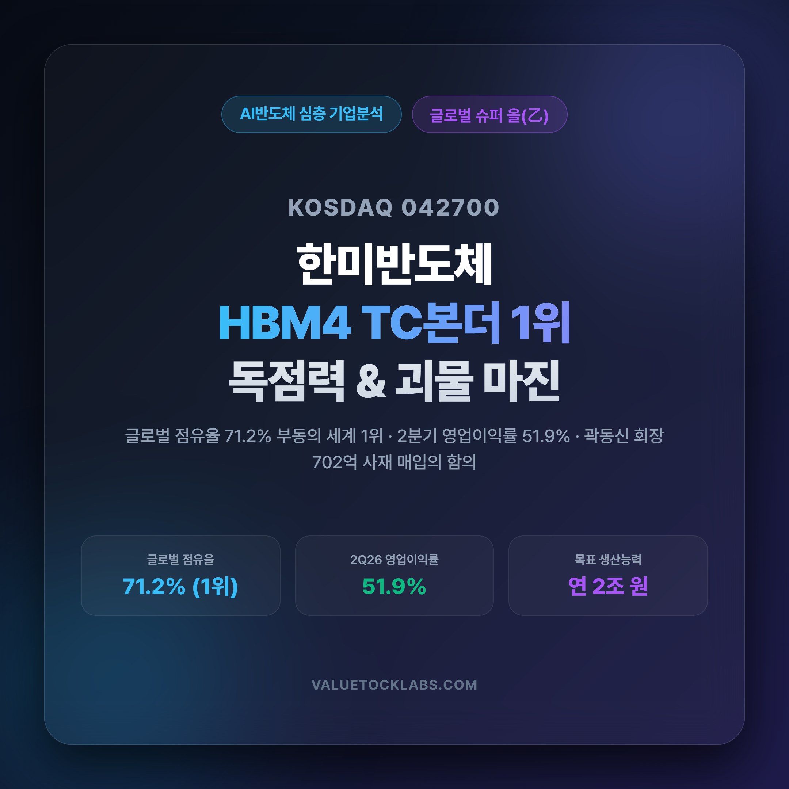
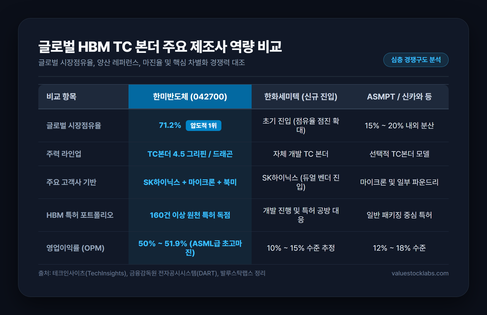
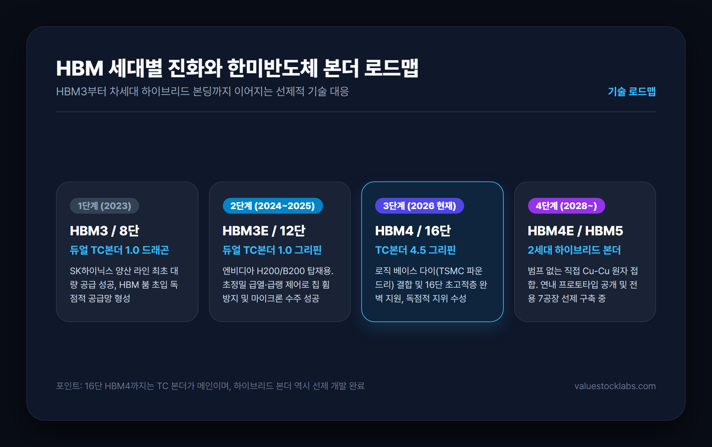
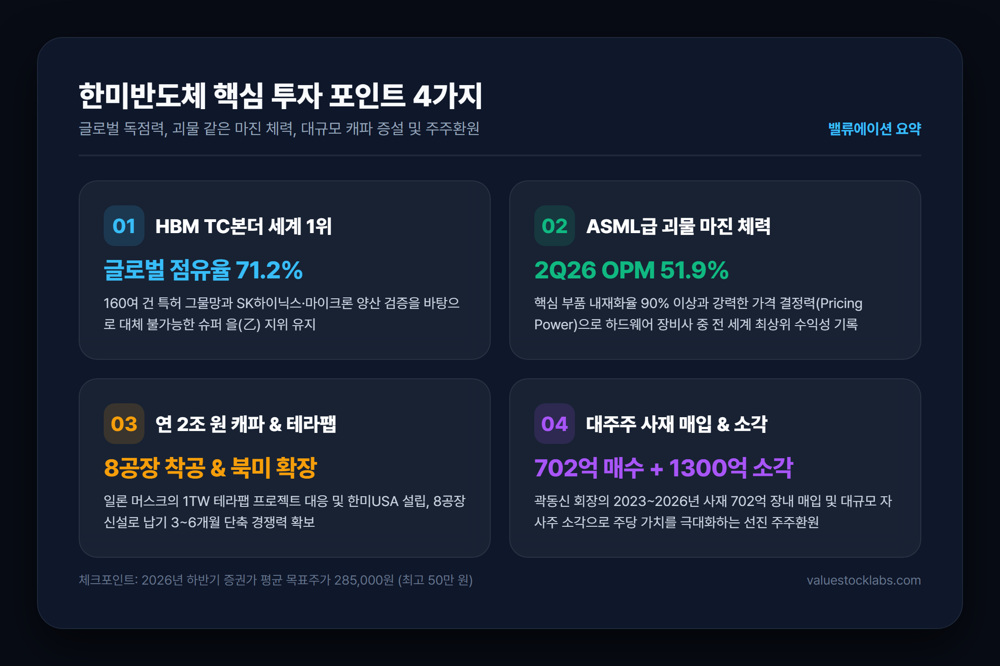
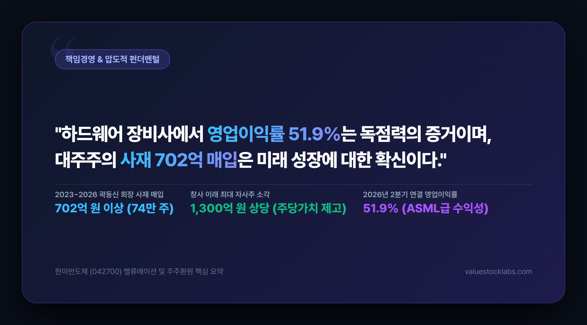

# 한미반도체 주가 전망 및 2026 실적 분석: HBM4 TC본더 1위의 독점력과 괴물 마진

> 글로벌 HBM TC 본더 점유율 71.2%의 절대강자 한미반도체(042700). 2026년 2분기 영업이익률 51.9%를 달성하며 입증한 괴물 같은 마진 체력과 차세대 HBM4 수주 모멘텀, 그리고 듀얼벤더 우려를 정밀 해부합니다.

---

## 목차
- [1. 서론: AI 반도체 슈퍼사이클과 HBM 후공정의 절대강자](#1-서론-ai-반도체-슈퍼사이클과-hbm-후공정의-절대강자)
- [2. HBM TC 본더 시장점유율 71.2%의 비밀과 독보적 기술 해자](#2-hbm-tc-본더-시장점유율-712의-비밀과-독보적-기술-해자)
- [3. 2026년 2분기 사상 최대 실적과 OPM 51.9% 괴물 마진율의 본질](#3-2026년-2분기-사상-최대-실적과-opm-519-괴물-마진율의-본질)
- [4. 고객사 다변화와 연 2조 원 캐파 증설: 테라팹과 북미 공급망 확장](#4-고객사-다변화와-연-2조-원-캐파-증설-테라팹과-북미-공급망-확장)
- [5. 곽동신 회장의 702억 사재 매입과 1,300억 자사주 소각의 의미](#5-곽동신-회장의-702억-사재-매입과-1300억-자사주-소각의-의미)
- [6. 시장 쟁점 진단: 한화세미텍 듀얼벤더 진입과 하이브리드 본딩 전환 이슈](#6-시장-쟁점-진단-한화세미텍-듀얼벤더-진입과-하이브리드-본딩-전환-이슈)
- [7. 결론 및 투자 전략: 증권가 컨센서스와 밸류에이션 리레이팅 조건](#7-결론-및-투자-전략-증권가-컨센서스와-밸류에이션-리레이팅-조건)

---

## 1. 서론: AI 반도체 슈퍼사이클과 HBM 후공정의 절대강자

인공지능(AI) 산업이 거대언어모델(LLM) 훈련을 넘어 실시간 추론 및 온디바이스 AI, 멀티모달 서비스로 급격히 확장되면서, 글로벌 빅테크 기업들의 고성능 AI 가속기 확보 경쟁은 날이 갈수록 치열해지고 있습니다. 엔비디아의 블랙웰(Blackwell) 및 루빈(Rubin), AMD의 인스팅트 시리즈 등 차세대 AI 가속기의 성능을 결정짓는 핵심 병목은 바로 **고대역폭메모리(HBM)**의 전송 속도와 적층 수율입니다.

HBM 제조의 핵심은 실리콘 관통 전극(TSV)으로 미세 구멍을 뚫은 복수의 D램 다이를 수직으로 빈틈없이 쌓아 올리는 초정밀 패키징 공정입니다. 이 공정의 승패를 가르는 장비가 바로 열압착 본더, 즉 **TC 본더(Thermal Compression Bonder)**입니다.

대한민국 코스닥 시가총액 최상위 소부장 기업인 **한미반도체(042700)**는 전 세계 HBM TC 본더 시장에서 압도적인 시장 점유율과 글로벌 1위 지위를 확고히 굳히며 반도체 후공정 업계의 '슈퍼 을(Super B2B)'로 자리매김했습니다. 2026년 2분기 사상 최대 실적 경신과 함께 분기 영업이익률 51.9%라는 경이적인 성적표를 받아든 한미반도체의 펀더멘털과 핵심 투자 포인트를 심층 분석해 봅니다.

---

## 2. HBM TC 본더 시장점유율 71.2%의 비밀과 독보적 기술 해자

글로벌 시장조사기관 테크인사이츠(TechInsights)의 집계에 따르면, 한미반도체는 고성능 HBM용 TC 본더 시장에서 **약 71.2%의 압도적인 점유율**을 기록하고 있습니다. 전 세계 HBM의 10개 중 7개 이상이 한미반도체의 장비를 거쳐 생산되고 있는 셈입니다.

한미반도체가 이토록 확고한 기술적 해자를 구축할 수 있었던 비결은 다음 세 가지로 요약됩니다.

### ① 듀얼 헤드 구조와 정밀 온도 제어 메커니즘
기존 싱글 헤드 본더와 달리, 한미반도체의 '듀얼 TC 본더(Dual TC Bonder)'는 2개의 본딩 헤드가 독립적으로 구동하며 웨이퍼 상의 칩을 교차 압착합니다. 이를 통해 단위 시간당 생산성(UPH)을 기존 대비 2배 이상 끌어올렸으며, 0.1도 단위의 초정밀 급속 가열 및 급랭 기술을 구현해 열팽창 계수 차이로 인한 칩 휨(Warpage) 현상을 완벽에 가깝게 억제했습니다.

### ② 독보적인 160여 건의 특허 방어막
한미반도체는 2002년 장비 업계 최초로 지적재산(IP)부를 독립 부서로 승격시키고 원천 특허를 전략적으로 출원해 왔습니다. HBM 본딩 관련 특허만 160건 이상을 보유하고 있으며, 칩 평탄화 기술, 플럭스 도포 동시 비전 검사 시스템 등 핵심 공정 단계마다 특허 그물망을 쳐 후발 주자들의 카피캣 진입을 법적으로 완벽히 봉쇄하고 있습니다.

### ③ HBM4 전용 'TC 본더 4.5 그리핀'의 선제적 출시
HBM이 5세대(HBM3E) 8단/12단에서 6세대(HBM4) 16단으로 넘어가면서 베이스 다이가 파운드리 최첨단 로직 공정(TSMC 3nm/4nm 등)으로 제작됩니다. 한미반도체는 이에 발맞춰 16단 초고적층 및 와이드 베이스 다이에 최적화된 **'TC 본더 4.5 그리핀'**을 세계 최초로 양산 납품하며 차세대 규격에서도 표준 지위를 선점했습니다.

---

## 3. 2026년 2분기 사상 최대 실적과 OPM 51.9% 괴물 마진율의 본질

2026년 1분기까지만 해도 시장 일각에서는 "HBM3E 발주가 일단락되고 HBM4로 넘어가는 과도기적 공백기에 한미반도체의 실적이 꺾이는 것 아니냐"는 이른바 '피크아웃(Peak-out)' 우려가 존재했습니다. 그러나 2026년 2분기 실적 발표는 이러한 시장의 의구심을 단숨에 불식시켰습니다.

| 지표 (연결 기준) | 2024년 결산 | 2025년 결산 | 2026년 2분기 (단일) | 2026년 연간 전망(F) |
|---|---|---|---|---|
| **매출액** | 5,593억 원 | 6,850억 원 | **2,511억 원** (+39.5% YoY) | **8,800억 ~ 9,200억 원** |
| **영업이익** | 2,490억 원 | 3,210억 원 | **1,303억 원** (+51.0% YoY) | **4,400억 ~ 4,700억 원** |
| **영업이익률 (OPM)** | 44.5% | 46.9% | **51.9%** (사상 최대) | **50.0% ~ 51.5%** |
| **당기순이익** | 2,150억 원 | 2,890억 원 | **1,085억 원** | **4,000억 ~ 4,300억 원** |

### 50%를 상회하는 괴물 마진율이 가능한 구조적 배경
제조업, 그것도 하드웨어 장비사가 50%가 넘는 영업이익률을 달성한다는 것은 전 세계를 통틀어도 극소수에 불과합니다(ASML의 극자외선 노광장비 부문 수준). 한미반도체가 이러한 마진율을 유지할 수 있는 이유는 세 가지입니다:
1. **핵심 부품 내재화율 90% 이상**: 주물 가공부터 초정밀 서보모터 제어기, 전장 소프트웨어까지 자체 생산하여 외부 벤더에 지급하는 마진을 극단적으로 줄였습니다.
2. **독점적 가격 협상력(Pricing Power)**: HBM 수율 1~2% 차이에 수조 원의 매출이 오가는 메모리 제조사 입장에서, 검증된 한미반도체의 장비는 가격 저항선이 매우 낮습니다.
3. **고정비 레버리지 효과**: 매출이 조 단위로 성장하는 구간에서 표준화된 모듈 생산 방식을 정착시켜 추가 매출 발생 시 영업이익으로 전환되는 한계마진(Incremental Margin)이 70%에 달합니다.

---

## 4. 고객사 다변화와 연 2조 원 캐파 증설: 테라팹과 북미 공급망 확장

한미반도체의 약점으로 지적되던 단일 고객사(SK하이닉스) 편중 리스크는 글로벌 고객사 확보와 생산능력 확장을 통해 빠르게 해소되고 있습니다.

### ① 마이크론 테크놀로지 공급 성공과 글로벌 침투
미국 1위 메모리 제조사인 마이크론(Micron)은 엔비디아 납품을 위한 HBM3E 및 HBM4 라인에 한미반도체의 듀얼 TC 본더를 대규모로 채택했습니다. 이는 한미반도체가 특정 메모리 제조사에 얽매이지 않고 글로벌 표준 장비사로 우뚝 섰음을 공식 입증한 사건입니다.

### ② 일론 머스크의 1TW '테라팹(Terafab)'과 한미USA
일론 머스크가 테슬라, xAI, 스페이스X의 AI 반도체를 자체 생산·패키징하기 위해 미국 텍사스에 추진 중인 초대형 기지 '테라팹(Terafab)'은 전력 규모만 1테라와트(TW)에 달하는 전대미문의 프로젝트입니다.
- 테라팹의 핵심은 연산 로직 다이와 HBM, I/O 칩렛을 고밀도로 결합하는 첨단 패키징입니다.
- 한미반도체는 북미 현지 법인 **'한미USA(Hanmi USA)'**를 설립하고 와이드 TC 본더 및 2.5D 패키징 장비 공급망 진입을 전방위로 추진하고 있습니다.
- 또한 스페이스X 지분 500억 원 투자 관계를 레버리지 삼아 북미 빅테크 생태계와 긴밀한 파트너십을 맺고 있습니다.

### ③ 8공장 신설과 연간 생산능력 2조 원 체제 도약
- **1~6공장**: 이미 완공된 인천 본사 6개 공장을 통해 연간 1조 원 규모의 생산능력을 확보했습니다.
- **7공장**: 차세대 하이브리드 본더 전용 클린룸으로 연내 가동 예정입니다.
- **8공장 (주안국가산단)**: 창사 이래 최대 규모의 부지를 확보하여 착공한 8공장이 완공되면 한미반도체의 총생산능력은 **연간 2조 원** 수준으로 확대됩니다. 이는 경쟁사 대비 납기(Lead Time)를 절반 이하인 3~6개월로 단축할 수 있는 무기입니다.

---

## 5. 곽동신 회장의 702억 사재 매입과 1,300억 자사주 소각의 의미

국내 코스닥 시장에서 찾아보기 힘든 강력한 주주친화 정책과 책임경영은 한미반도체만의 특별한 프리미엄 요소입니다.

### ① 곽동신 회장의 지속적인 사재 자사주 장내 매수
최대주주인 곽동신 대표이사 회장은 2023년부터 2026년 10월 현재까지 지속적으로 본인의 사재를 털어 자사주를 장내 매수해 왔습니다.
- **누적 취득 금액**: **702억 원 이상** (약 74만 주 이상)
- **지분율**: 33.63%로 경영권 방어 및 대주주 책임성 강화
- 특히 회사의 성장 사이클에서 수령한 배당금 전액을 초과하는 현금을 주식 매입에 재투입함으로써, "경영진과 소액주주의 운명을 일치시키겠다"는 강력한 자신감을 표명했습니다.

### ② 1,300억 원 규모의 대규모 자기주식 소각
한미반도체는 2025년 초 창사 이래 최대 규모인 **1,300억 원 상당(약 130만 주)의 자사주 소각**을 완료했습니다. 이는 주식을 매입하여 금고에 쌓아두는 소극적 주주환원이 아니라, 발행주식수를 영구적으로 줄여 주당순이익(EPS)과 주당순자산(BPS)을 즉각 높이는 가장 선진적인 형태의 주주환원입니다.

---

## 6. 시장 쟁점 진단: 한화세미텍 듀얼벤더 진입과 하이브리드 본딩 전환 이슈

투자자라면 한미반도체를 둘러싼 두 가지 핵심 쟁점과 잠재적 리스크를 객관적으로 짚고 넘어가야 합니다.

### 쟁점 1: 한화세미텍(한화정밀기계) 퀄 통과와 듀얼벤더화
2025년 3월, 한화세미텍이 SK하이닉스의 HBM용 TC 본더 퀄테스트를 통과하고 양산 납품을 시작하면서, 시장 일각에서는 한미반도체의 독점 체제가 붕괴되고 단가 인하 압력이 거세질 것이라는 우려가 제기되었습니다.
- **팩트 점검**: SK하이닉스가 공급망 안정화를 위해 복수 벤더를 둔 것은 사실입니다.
- **영향 평가**: 그러나 한미반도체는 16단 및 HBM4용 'TC 본더 4.5 그리핀'의 성능 우위와 오랜 수율 노하우를 바탕으로 여전히 핵심 메인 라인을 장악하고 있습니다. 또한 마이크론 수주와 북미 고객사 확장으로 SK하이닉스 의존도를 분산하고 있어, 점유율의 일부 분할에도 불구하고 전체 매출 외형은 지속 성장하는 양상입니다.

### 쟁점 2: 16단 이후 하이브리드 본딩 전환에 따른 TC본더 수요 감소 우려
칩과 칩 사이에 범프 없이 구리를 직접 맞닿게 하는 하이브리드 본딩(Hybrid Bonding)이 도입되면 기존 TC 본더가 무용지물이 될 것이라는 기술적 공포가 있었습니다.
- **팩트 점검**: 실제 메모리 업계의 기술 로드맵 확인 결과, 16단 HBM4까지는 공정 난이도와 천문학적 설비 비용 때문에 기존 어드밴스드 MR-MUF 기반의 TC 본더가 메인으로 활용되고 있습니다.
- **대응 현황**: 하이브리드 본딩의 전면 도입은 2028~2029년경 20단 이상 HBM5 세대로 이연되는 분위기이며, 한미반도체는 이미 연내 2세대 하이브리드 본더 프로토타입을 공개하고 전용 7공장을 구축하며 기술 전환기에도 주도권을 놓치지 않을 채비를 마쳤습니다.

---

## 7. 결론 및 투자 전략: 증권가 컨센서스와 밸류에이션 리레이팅 조건

2026년 하반기 현재 국내외 주요 증권사들이 제시하는 한미반도체의 평균 목표주가는 **285,000원** 선(범위: 240,000원 ~ 350,000원, 글로벌 IB 최대 500,000원)에 형성되어 있습니다.

### 핵심 투자 포인트 요약
1. **ASML급 마진율(OPM 51.9%)**: 반도체 후공정 장비사 중 전 세계 독보적 1위의 수익 창출력.
2. **HBM4 슈퍼사이클 선점**: 16단 초고적층 및 로직 베이스 다이 결합을 완벽 지원하는 'TC 본더 4.5 그리핀'의 수주 본격화.
3. **생산능력 2조 원 체제와 글로벌 확장**: 8공장 증설, 마이크론 수주, 일론 머스크 테라팹 및 북미 팹리스 공략.
4. **대주주의 사재 매입과 자사주 소각**: 코리아 디스카운트를 극복하는 주주가치 극대화 정책.

단기적으로는 12개월 선행 PER이 30~40배 수준으로 형성되어 있어 글로벌 매크로 환경이나 반도체 팹리스의 투자 속도 조절에 따른 주가 변동성이 나타날 수 있습니다. 그러나 HBM4 양산이 본격화되고 북미향 대규모 수주 공시가 가시화되는 시점마다 기업가치는 한 단계 더 레벨업될 가능성이 높습니다. 중장기적 관점에서 AI 반도체 밸류체인의 필수 불가결한 핵심 장비주로 지속적인 관심이 유효합니다.

---

*면책 조항: 본 글은 공시 자료 및 신뢰할 수 있는 보도 자료를 바탕으로 작성된 정보 제공 목적의 분석 글이며, 특정 금융투자상품에 대한 매수 또는 매도 권유가 아닙니다. 모든 투자의 최종 결정과 손익에 대한 책임은 투자자 본인에게 있습니다.*

### 참고 출처 (References)
1. 한미반도체 공식 IR 공시 및 사업보고서 (www.hanmisemi.com)
2. 전자신문: "한미반도체, 2분기 사상 최대 실적…영업이익률 51.9% 달성" (2026)
3. 테크인사이츠(TechInsights): "글로벌 HBM TC본더 시장 점유율 분석 보고서"
4. 디일렉(THE ELEC): "HBM4 16단 양산 돌입과 한미반도체 TC본더 4.5 그리핀 공급망 진단"
5. 데일리안 & 더벨: "곽동신 회장 702억 사재 매입과 1,300억 자사주 소각의 주주가치 제고 효과"
6. 한국경제: "SK하이닉스-마이크론 HBM 장비 수주 및 북미 테라팹 프로젝트 공급망 분석"
